# System Design: FLAG

**PRD:** [prd-flag.md](prd-flag.md)

---

## 1. Architecture

One Next.js App Router application in `web/`, deployed to Cloudflare Workers Free (`*.workers.dev`) through the OpenNext Cloudflare adapter. Server components and route handlers read and write D1 (SQLite) through Drizzle. Proof files live in a private R2 bucket and only ever pass through the Worker; no bucket is public and no presigned URL is issued. Better Auth handles sessions with email one-time-code sign-in as the launch method; Google sign-in is optional when keys are configured. Turnstile stays disabled until site and secret keys exist. Email goes out through `sendMail`, which selects Brevo when `BREVO_API_KEY` is set, else Resend, else a dev-console no-op (LOG 2026-10-12). No SMS provider is used anywhere: pilot verification is manual live inspection, not a phone-code flow.

Retention needs maintenance, so a daily Workers Cron `scheduled()` event invokes `runRetentionMaintenance` (planned: `web/src/features/maintenance/run.ts`; invocation-wrapper wiring lands with the implementation). There is no public unauthenticated purge endpoint. Every read hides expired records regardless of whether maintenance has run yet.

Every page except the landing page, sign-in, sign-up, legal pages, and the invite landing page sits in an authenticated route group. Authorization is checked a second time in the data-access layer, so a page that forgets the check still cannot read another party's data.

Deployment target: Cloudflare Workers Free plan on `*.workers.dev` (LOG Q4); no custom domain for the pilot. Environments: production (`flag`/`flag-db`, branch `main`) and preview (`flag-dev`/`flag-db-dev`, branch `dev`), each with its own D1 database and per-env secrets.

```
Browser (Chrome on Android, Messenger in-app browser, desktop)
   |
   v
Cloudflare Worker  ---  OpenNext adapter  ---  Next.js (web/)
   |        |              |
   |        |              +-- Better Auth  (sessions, email OTP; Google optional)
   |        +-- Turnstile verify (disabled without keys), Rate Limiting binding
   |        +-- Cron scheduled()  -->  runRetentionMaintenance (planned)
   |
   +-- D1  (accounts, profiles, engagements, logs, revisions, cases, audit)
   +-- R2  (private proof files, keyed by log)
   +-- Brevo / Resend (outbound email via sendMail)
```

## 2. Components

Issue #5 wires PROOFS to separate configured buckets at `web/wrangler.jsonc:30` and `web/wrangler.jsonc:55`, with local R2 emulation and generated binding types. Both remote buckets were provisioned and verified empty, Standard, and private during the 2026-10-21 follow-up (OPS §1/§5). Active deployed Workers still lack PROOFS; no proof workflow is released. The local Workers tests exercise storage primitives (`web/tests/f03-storage.test.ts:1`). The account pin and read-only R2 audit are at `web/scripts/check-resource-bindings.mjs:2` and `web/scripts/audit-r2.mjs:1`; these do not enforce runtime spending quotas or guarantee a $0 invoice.

Locations under `web/`. Built so far: Auth, Onboarding, Data access for the account tables, Mail. Each feature folder is owned by one developer (BUILD §4). `CLIENT_REPLY` and `CORROBORATION` from the prior design are removed: PRD-F5 and PRD-F10 are Retired, and no reply, same-experience, upvote, or agreement-count path is designed, stored, or rendered.

| Component | Responsibility | Serves | Location |
|-----------|---------------|--------|----------|
| Auth | Sessions, sign-in methods, roles, the `requireViewer` guard. Better Auth core plus the email-OTP plugin; the admin plugin is not used, so there is no impersonation. Google sign-in activates only when keys are configured | PRD-F7, PRD-F1 | `web/src/server/auth` |
| Onboarding | Policy versions, acknowledgment screens, the acceptance gate | PRD-F8 | `web/src/features/onboarding` |
| Verification | Manual live ID inspection case, portfolio links, verification case submission. No phone-OTP step, no QR body, no ID image or number handling | PRD-F1 | `web/src/features/verification` |
| Engagements | Create engagement, invite link, client sign-up and accept or decline, client profile; rejects self-invites; never auto-merges on names | PRD-F9 | `web/src/features/engagements` |
| Logs | Log form, rating input, covered work period and optional amount, tag rules, 15-day window check, proof upload and streaming, submission, filer updates as new revisions | PRD-F2, PRD-F3, PRD-F14 | `web/src/features/logs` |
| Moderation | Queue, claim lock, decisions with reasons (approve / ask-changes / reject; corrections: uphold / ask-changes / correct / withdraw), audit trail, conflict checks including reviewer-different rule for corrections | PRD-F4, PRD-F13 | `web/src/features/moderation` |
| Records | Client search, client record page, read-time average with contributor count and Limited-record label, outcome counts, tags. No scores beyond the approved rating and average; no replies; no corroboration | PRD-F6, PRD-F14 | `web/src/features/records` |
| Maintenance | Daily retention run: expiry, draft and rejected purges, withdrawn-deadline and abandoned ask-changes/update purges, closure purges, abandoned-proof and R2-orphan cleanup, audit and metadata purges, hold-aware deletion. Planned; invoked by Cron, never by a public route | PRD-F12 | `web/src/features/maintenance/run.ts` |
| Data access | Drizzle schema, queries that take a viewer and enforce relationship rules; every record read hides expired rows | all | `web/src/server/db` |
| Design system | shadcn components on Base UI, tokens, outcome marks | all | `web/src/components` |
| Mail | `sendMail` helper (Brevo, else Resend, else dev no-op) and templates | PRD-F11 | `web/src/server/mail` |

## 3. Data model

**Schema file:** `web/src/server/db/schema.ts` (USER, SESSION, ACCOUNT, AUTH_VERIFICATION, AUTH_RATE_LIMIT, POLICY_ACCEPTANCE, FREELANCER_PROFILE, VERIFICATION_CASE, PORTFOLIO_LINK, CLIENT_PROFILE, and ENGAGEMENT exist. Issue #5 adds ENGAGEMENT_LOG, LOG_REVISION, LOG_TAG, and PROOF_FILE at `web/src/server/db/schema.ts:259`, `:291`, `:329`, and `:346`. Only auth/onboarding workflows are implemented; the new tables are a local schema foundation, not released log/proof functionality. The remaining entities are design-first.)

The ERD below is the schema contract (hard rule 16): code may only use the entities, fields, and relationships it defines. Types are D1/SQLite storage types as Drizzle will declare them: `text` (including ISO-8601 timestamps and enum values), `integer` (including booleans as 0/1, the 1-5 rating, and money in centavos). The account tables keep their exact built fields; the `phone_number` columns on USER are existing and stay, but no pilot flow reads or requires them.

### 3.1 Entity-relationship diagram

```mermaid
erDiagram
    USER ||--o{ SESSION : has
    USER ||--o{ ACCOUNT : links
    USER ||--o{ POLICY_ACCEPTANCE : accepts
    USER |o--o| FREELANCER_PROFILE : "is"
    USER |o--o| CLIENT_PROFILE : "is"
    USER ||--o{ AUDIT_EVENT : performs
    USER ||--o{ DATA_REQUEST : files
    USER ||--o{ VERIFICATION_CASE : reviews
    USER ||--o{ LOG_REVISION : submits
    USER ||--o{ PROOF_FILE : uploads
    USER ||--o{ CORRECTION_REQUEST : files
    USER |o--o{ MODERATION_CASE : decides
    FREELANCER_PROFILE ||--o{ VERIFICATION_CASE : undergoes
    FREELANCER_PROFILE ||--o{ PORTFOLIO_LINK : lists
    FREELANCER_PROFILE ||--o{ ENGAGEMENT : opens
    CLIENT_PROFILE |o--o{ ENGAGEMENT : accepts
    ENGAGEMENT ||--o| ENGAGEMENT_LOG : "is logged by"
    ENGAGEMENT_LOG ||--o{ LOG_REVISION : versions
    ENGAGEMENT_LOG ||--o{ CORRECTION_REQUEST : "challenged by"
    LOG_REVISION ||--o{ LOG_TAG : carries
    LOG_REVISION |o--o{ PROOF_FILE : binds

    USER {
        text id PK
        text name
        text email UK
        integer email_verified
        text image "nullable"
        text role "nullable until chosen at onboarding; freelancer | client | moderator | admin"
        integer banned
        text ban_reason "nullable"
        text closed_at "nullable, design-first addition, needs future migration; set when the account is closed"
        text phone_number UK "nullable, existing column, unused by pilot verification"
        integer phone_number_verified
        text created_at
        text updated_at
    }
    SESSION {
        text id PK
        text user_id FK
        text token UK
        text expires_at
        text ip_address "nullable"
        text user_agent "nullable"
        text created_at
        text updated_at
    }
    ACCOUNT {
        text id PK
        text user_id FK
        text provider_id "google | credential"
        text account_id
        text access_token "nullable, secret"
        text refresh_token "nullable, secret"
        text id_token "nullable, secret"
        text access_token_expires_at "nullable"
        text refresh_token_expires_at "nullable"
        text password "nullable, always null; Better Auth core column, no password sign-in"
        text scope "nullable"
        text created_at
        text updated_at
    }
    AUTH_VERIFICATION {
        text id PK
        text identifier
        text value "one-time code, hashed"
        text expires_at
        text created_at
        text updated_at
    }
    POLICY_ACCEPTANCE {
        text id PK
        text user_id FK
        text policy "privacy | terms | freelancer_ack | client_consent"
        text version
        text accepted_at
        text retired_at "nullable until retired; planned, future migration: anchors the inactive-consent purge deadline"
    }
    AUTH_RATE_LIMIT {
        text key PK "domain-separated HMAC; no raw IP or email"
        integer count "positive request count"
        integer expires_at "Unix milliseconds; fixed window expiry"
    }
    FREELANCER_PROFILE {
        text user_id PK, FK
        text display_name
        text city "nullable"
        text status "unverified | pending | verified | rejected | suspended"
        text verified_at "nullable"
        text created_at
    }
    VERIFICATION_CASE {
        text id PK
        text freelancer_id FK
        text reviewer_id FK "moderator who did the live inspection"
        text method "live_manual"
        text id_kind "philid | ephilid | passport | drivers_licence"
        text result "pass | fail"
        integer name_match "0 | 1"
        text inspected_at
        text decision "nullable, approve | reject"
        text reason "nullable"
        text decided_at "nullable"
        text created_at
    }
    PORTFOLIO_LINK {
        text id PK
        text freelancer_id FK
        text url
        text label "nullable"
    }
    CLIENT_PROFILE {
        text id PK
        text user_id FK, UK
        text display_name
        text kind "individual | business"
        text city "nullable"
        text registration_no "nullable, DTI or SEC"
        text created_at
    }
    ENGAGEMENT {
        text id PK
        text freelancer_id FK
        text client_id FK "nullable until accepted"
        text title
        text client_name_hint
        text started_on
        text ended_at "nullable, completion or termination date"
        text status "invited | accepted | declined | expired | cancelled"
        text invite_token_hash UK
        text invite_expires_at
        text accepted_at "nullable"
        text declined_at "nullable"
        text created_at
    }
    ENGAGEMENT_LOG {
        text id PK
        text ref UK "human reference, e.g. FL-1042, monotonic for tiebreaks"
        text engagement_id FK, UK
        text freelancer_id FK
        text client_id FK
        text current_revision_id FK "nullable until first approval"
        text status "draft | pending | ask_changes | published | hidden | withdrawn | rejected | expired"
        text anchor_kind "completed | terminated | missed_milestone"
        text anchor_date "event date the 15-day clock runs from"
        text first_submitted_at "nullable, immutable once set"
        text submitted_at "nullable, latest submission"
        text published_at "nullable, original publication, immutable"
        text expires_at "nullable, original publication plus 12 months"
        text hold_kind "nullable, review | legal"
        text hold_placed_at "nullable"
        text hold_released_at "nullable"
        text created_at
    }
    LOG_REVISION {
        text id PK
        text log_id FK
        integer rev_no "1, 2, 3, immutable per log"
        text kind "initial | filer_update | correction"
        integer rating "1 to 5"
        text outcome "negative | mixed | positive, derived from rating"
        text facts
        text period_start "covered work start date, required; separate from the filing anchor"
        text period_end "covered work end date, required, >= period_start"
        integer amount_centavos "nullable, optional, >= 0 when supplied; no currency conversion"
        text submitted_by FK
        text submitted_at
        text decided_by FK "nullable"
        text decided_at "nullable"
        text decision "nullable, approve | ask_changes | reject | correct | withdraw | uphold"
        text reason "nullable"
    }
    LOG_TAG {
        text revision_id PK, FK
        text tag PK "fixed set of eight"
    }
    PROOF_FILE {
        text id PK
        text log_id FK
        text revision_id FK "nullable until bound on submit"
        text owner_kind "filer | client"
        text uploaded_by FK
        text object_key UK "R2 key"
        text kind "screenshot | invoice | agreement | chat | other"
        text mime "image/jpeg | image/png | image/webp | application/pdf"
        integer size_bytes
        text sha256
        text status "uploading | attached | abandoned | pending_purge | purged"
        text uploaded_at
    }
    CORRECTION_REQUEST {
        text id PK
        text log_id FK
        text requester_id FK
        text requester_kind "client | filer"
        text reason
        text status "open | decided"
        text decision "nullable, uphold | ask_changes | correct | withdraw"
        text decided_by FK "nullable, independent unconflicted moderator"
        text decided_at "nullable"
        text created_at
    }
    MODERATION_CASE {
        text id PK
        text kind "verification | log | correction | filer_update"
        text subject_id "id of the row under review"
        text status "open | claimed | decided"
        text claimed_by FK "nullable"
        text claimed_until "nullable"
        text decision "nullable, approve | ask_changes | reject | uphold | correct | withdraw"
        text reason "nullable"
        text decided_by FK "nullable"
        text decided_at "nullable"
        text created_at
    }
    AUDIT_EVENT {
        text id PK
        text actor_id FK "nullable for system events"
        text action
        text subject_type
        text subject_id
        text created_at
    }
    DATA_REQUEST {
        text id PK
        text user_id FK
        text kind "export | correct | delete | close"
        text status "open | done | declined"
        text note "nullable, no PII"
        text created_at
        text resolved_at "nullable"
    }
```



`AUTH_VERIFICATION` is Better Auth's one-time-code table, renamed so it is not confused with freelancer verification. It has no relationship lines because Better Auth keys it by email identifier, not by user id. `MODERATION_CASE.subject_id` has no foreign key because the subject is polymorphic per `kind`; integrity is checked by the handler.

`AUDIT_EVENT` carries ids, action, and time only. It has no content column by design: review history and facts live on `LOG_REVISION`, `CORRECTION_REQUEST`, and `MODERATION_CASE`, never in the audit trail.

### 3.2 Entity register

| Entity | Serves | Constrained by | Data class | Retention | Notes |
|--------|--------|----------------|------------|-----------|-------|
| USER | PRD-F7 | INV-8 | PII | Life of account; close handled within 30 days with individual assessment; a closed account deactivates with access revoked and its USER row retained as a stub until retained links expire | Better Auth core table plus role, ban, closed_at (design-first, needs future migration), and legacy phone fields |
| SESSION | PRD-F7 | INV-7 | PII | Until expiry | Better Auth core |
| ACCOUNT | PRD-F7 | — | secret | Life of account | Better Auth core; OAuth tokens |
| AUTH_VERIFICATION | PRD-F7 | — | secret | Until code expiry | Better Auth email one-time codes |
| AUTH_RATE_LIMIT | PRD-F7 | — | internal | Expired buckets removed on authentication requests | HMAC of trusted IP and route, plus normalized email on OTP routes; no raw IP/email; cr-001 |
| POLICY_ACCEPTANCE | PRD-F8, PRD-F9 | INV-8 | internal | Current effective rows stay while needed to gate an active account and are never purged by the gate; retired rows purge 12 months after the retired_at anchor (policy superseded/inactive, account closure, or consented-purpose end), with holds excepted | Append-only except authorized maintenance purge; retired_at is a timestamp only, no PII; planned field, future migration |
| FREELANCER_PROFILE | PRD-F1 | INV-3, INV-8 | PII | Life of account | No ID hash, image, or number column of any kind |
| VERIFICATION_CASE | PRD-F1 | INV-3 | internal | 12 months after case close (minimal); never holds raw ID data | Reviewer, method, result, name-match, and time only |
| PORTFOLIO_LINK | PRD-F1 | — | PII | Life of account | |
| CLIENT_PROFILE | PRD-F9, PRD-F6 | INV-6 | PII | Life of account | Exactly one per client user; never auto-merged |
| ENGAGEMENT | PRD-F9 | INV-2 | internal | Life of the client record | Invite token stored hashed; self-invites rejected |
| ENGAGEMENT_LOG | PRD-F2, PRD-F6, PRD-F14 | INV-1, INV-2, INV-5, INV-6 | PII | Published 12 months after ORIGINAL publication; withdrawn inherits the original-publication 12-month deletion deadline but leaves reads and rating immediately; abandoned unpublished ask-changes follows idle-draft 30 days with its case closed as abandoned; rejected material 30 days after final decision | One per engagement; original dates immutable; holds delay deletion only |
| LOG_REVISION | PRD-F2, PRD-F4, PRD-F13, PRD-F14 | INV-1, INV-6 | PII | With its log; an abandoned proposed update to a still-published log purges only the unapproved revision and its proofs after 30 days idle while the active publication keeps its original 12-month deadline | Immutable once decided; current publication reads the current revision; carries the covered work period and optional amount |
| LOG_TAG | PRD-F2, PRD-F6 | — | internal | With its revision | Fixed set of eight; no tag rule overrides the star-derived outcome |
| PROOF_FILE | PRD-F3 | INV-2, INV-4 | PII | With its log for 12 months; abandoned uploads purged with their draft; proofs of a purged unapproved revision purged with it | Bytes in R2 keyed by object_key; owner and uploader recorded |
| CORRECTION_REQUEST | PRD-F13 | INV-6 | PII | 12 months after case close (minimal moderation history) | One open per log; repeats need new evidence |
| MODERATION_CASE | PRD-F4, PRD-F1, PRD-F13 | INV-1 | internal | 12 months after case close | Polymorphic subject |
| AUDIT_EVENT | PRD-F4, PRD-F12 | INV-3 | internal | 12 months after case close; ids and action only | Append-only except authorized maintenance purge; no content column |
| DATA_REQUEST | PRD-F12 | — | PII | 12 months after case close | Export, correction, deletion, and close requests |

### 3.3 Constraints and indexes

Issue #5 implements the new tables' CHECK, UNIQUE, and foreign-key constraints in `web/src/server/db/schema.ts:259` onward. Covered-period and anchor dates must be real canonical YYYY-MM-DD dates; invalid SQLite date results are rejected explicitly. A composite foreign key keeps the current revision and each bound proof on their own parent log, backed by UNIQUE LOG_REVISION(id, log_id); UNIQUE LOG_REVISION(log_id, rev_no) prevents duplicate revision numbers. New foreign keys use RESTRICT. Submission/filing-window, frozen-content, moderation, and retention triggers described below remain planned for their corresponding workflow issues; this foundation adds no mutation or read endpoint. Human-reference allocation remains the intake handler's responsibility.

AUTH_RATE_LIMIT (cr-001): PRIMARY KEY(key), CHECK(count >= 1), INDEX(expires_at). A conditional UPSERT admits a request only while below its limit or after expiry; the check and increment are atomic across Worker instances. OTP send and verification have separate five-request/fifteen-minute buckets keyed by IP+normalized email+route. Expired buckets are deleted on auth requests; no raw identifying values are stored. The general auth burst limit uses the same durable storage. Missing trusted IP falls back to a shared bucket, never a client-supplied forwarded address.

| Constraint | On | Why | Enforces |
|------------|----|-----|----------|
| CHECK (`typeof(rating) = 'integer'` AND `rating BETWEEN 1 AND 5`) | LOG_REVISION | SQLite column affinity is advisory, so the type check is the real backstop: it rejects 2.5 and text at the DB level, not just in the handler (SQLite datatype note, https://www.sqlite.org/datatype3.html, verified 2026-10-13: affinity recommended, not required) | PRD-F14 |
| CHECK `outcome` matches the rating band (1-2 negative, 3 mixed, 4-5 positive) | LOG_REVISION | Outcome is derived, never entered; handler sets both atomically | PRD-F14 |
| CHECK `tag IN` the eight fixed tags | LOG_TAG | No free-text tags; tags explain nuance and never override the derived outcome | PRD-F2 |
| CHECK `period_end >= period_start` (ISO-8601 text compares lexically) | LOG_REVISION | Covered work period is valid and ordered | PRD-F2 |
| CHECK `amount_centavos IS NULL OR (typeof(amount_centavos) = 'integer' AND amount_centavos >= 0)` | LOG_REVISION | Optional amount is a non-negative integer of centavos when supplied; the type check rejects fractions and text at the DB level | PRD-F2 |
| Status transition `draft -> pending` only if the engagement is `accepted`, the revision has at least one attached PROOF_FILE, and the 15-day window holds | ENGAGEMENT_LOG | Submit handler checks in one batch; a trigger rejects the update otherwise | INV-2 |
| 15-day window: `first_submitted_at <= anchor_date + 15 calendar days`, `anchor_date <= first_submitted_at` (no future anchor), anchor supported by engagement evidence | ENGAGEMENT_LOG | Handler date check plus trigger; published time is never the filing time | PRD-F2 |
| `first_submitted_at`, `anchor_kind`, `anchor_date`, `published_at`, `expires_at` immutable once set | ENGAGEMENT_LOG | Triggers reject UPDATE; ask-changes resubmissions continue the same log with no new filing and no clock reset | PRD-F2 |
| Status transition `pending -> published` only by the moderation decision handler, which sets `published_at` (first time only) and `expires_at` | ENGAGEMENT_LOG | One code path publishes | INV-1 |
| Revision rows immutable once decided; a filer update or correction creates a new revision, never an UPDATE | LOG_REVISION | Trigger rejects UPDATE/DELETE on decided revisions; unmoderated edits of the current publication are impossible | INV-6 |
| UNIQUE `engagement_id` | ENGAGEMENT_LOG | One log per engagement | PRD-F2 |
| UNIQUE `ref` | ENGAGEMENT_LOG | Human reference; monotonic tiebreak for ordering | PRD-F6 |
| Partial UNIQUE `log_id` WHERE `status = 'open'` | CORRECTION_REQUEST | One open correction per log; closed rows stay for history and repeats need new evidence | PRD-F13 |
| Repeat request after a closed one requires a PROOF_FILE owned by the requester and uploaded after the previous decision | CORRECTION_REQUEST | Handler check; ordinary disagreement without new evidence is rejected | PRD-F13 |
| Correction `decided_by` differs from the log's original decider and has no conflict (not the filer, the client, or engaged with that client) | CORRECTION_REQUEST | Handler check | PRD-F13 |
| UNIQUE `log_id` removals: no CLIENT_REPLY or CORROBORATION tables exist | — | PRD-F5 and PRD-F10 are Retired; nothing stores a reply, vote, or count | PRD-F5, PRD-F10 |
| UNIQUE `invite_token_hash` | ENGAGEMENT | Unguessable single-use invite | PRD-F9 |
| UNIQUE `user_id` | CLIENT_PROFILE | One client profile per account; duplicates resolved by moderator evidence check, never auto-merge | PRD-F9 |
| Self-invite rejected: `client_id` user must differ from the freelancer user | ENGAGEMENT | Handler check | PRD-F9 |
| No client mutation path to ENGAGEMENT_LOG, LOG_REVISION, LOG_TAG, or PROOF_FILE; frozen triggers reject direct edits after submission | ENGAGEMENT_LOG and children | No such server action exists | INV-6 |
| No content UPDATE on decided LOG_REVISION facts, rating, tags, or proofs; DELETE only by authorized maintenance purge | LOG_REVISION and children | Triggers reject content UPDATE always, and reject DELETE before the row's approved retention deadline or while an active hold applies; an expired eligible purge requested by the maintenance function is allowed by app authorization (see next row) | INV-6 |
| Append-only except authorized maintenance purge | AUDIT_EVENT, POLICY_ACCEPTANCE | Triggers reject app-issued UPDATE and DELETE; DELETE is permitted only to the privileged scheduled/internal maintenance path (`runRetentionMaintenance` via the Cron invocation) once the row's retention deadline has passed and no hold applies. No SQLite user, session, or other DB-principal identity is invented: enforcement is app authorization plus the deadline/hold checks, with no public route able to request a purge | PRD-F4, PRD-F8, PRD-F12 |
| No column holding a score, rank, leaderboard, endorsement, or trust value; the only rating signal is `rating` plus the read-time average | all | Reviewed in schema review; lint test allows `rating` and blocks score, rank, leaderboard, endorsement | INV-5 |
| No column holding a raw ID image, ID number, or ID hash | all | No ID hash column exists in v1; a future QR hash lands only after the deferred RFC plus an ERD update, before anything of that kind persists; nothing reads such a value today | INV-3 |
| INDEX `(status, created_at)` | MODERATION_CASE | Oldest-first queue | PRD-F4 |
| INDEX `(log_id, status)` | CORRECTION_REQUEST | One-open check and history | PRD-F13 |
| INDEX `(client_id, status, published_at)` | ENGAGEMENT_LOG | Client record page | PRD-F6 |
| INDEX `(log_id, rev_no)` | LOG_REVISION | Current-revision read and history | PRD-F2 |
| INDEX `display_name` (case-insensitive) | CLIENT_PROFILE | Client search | PRD-F6 |
| INDEX `(status, uploaded_at)` | PROOF_FILE | Abandoned-proof and orphan cleanup | PRD-F12 |
| FK RESTRICT on early USER delete; close deactivates with a stub row | USER as parent of SESSION, ACCOUNT, POLICY_ACCEPTANCE, profiles, revisions, proofs, requests, cases, and events | No USER delete while unexpired logs or proofs or unexpired minimal histories reference it; SESSION and ACCOUNT rows purge only after approved purge; erasure before expiry hides or withdraws the affected record and recalculates instead of anonymizing the publication | PRD-F12 |
| Ordered maintenance purge, R2 and D1 as separate services (NOT one atomic cross-store transaction) | ENGAGEMENT_LOG to LOG_REVISION, LOG_TAG, PROOF_FILE rows and R2 objects | Idempotent protocol using existing PROOF_FILE.status: the run claims D1 eligibility transactionally (deadline passed, no hold), marks rows `pending_purge`, retries the R2 delete to confirmation, then purges the confirmed D1 rows; parents purge only once eligible children are handled; failures retain the metadata needed for retry, and the orphan sweep is defined on `pending_purge` plus `abandoned` rows. No new table or column is declared for this | PRD-F12 |
| As-built deviation, needs future migration (no code change in this doc task) | `web/src/server/db/schema.ts` cascades SESSION, ACCOUNT, and POLICY_ACCEPTANCE on USER delete | POLICY_ACCEPTANCE must never cascade (12-month minimal consent history); SESSION and ACCOUNT cascade only after approved purge | PRD-F12 |
| `subject_id` has no foreign key; integrity checked by the handler per `kind` | MODERATION_CASE | Polymorphic subject | PRD-F4 |

Read-time aggregate contract (PRD-F6, PRD-F14). The client average is never stored: every record read first filters to eligible parent logs — status `published` with an active approved current revision, unexpired and unhidden — then takes the latest eligible approved published log per distinct freelancer/client pair, ordered by original `published_at` descending with `ref` ascending as the documented final tiebreak. Hidden, withdrawn, rejected, pending, ask-changes, draft, and expired logs never contribute. A new pending or rejected log never erases its pair's earlier eligible contribution, and a pending or rejected proposed update to a still-published log never changes the active approved rating used in the average. The average rounds to one decimal, always shows its distinct contributor count, and carries the Limited-record label under five contributors. Pending revisions (earliest submission and any current pending update), private requests, counter-proof, reviewer notes, and invalidated content are visible only to the filer, the named client, and moderators; everyone else reads the current published revision plus approved dated update metadata. Expiry hides a record on every read even if the maintenance run has not executed yet; a hold delays physical deletion but never extends visibility or rating contribution.

### 3.4 Migration policy

Drizzle Kit generates SQL migrations into `web/drizzle/`; Wrangler applies them (`wrangler d1 migrations apply`). Migrations are forward-only, reviewed in the pull request, applied to `preview` before `production`, and never edited after they reach `preview`. Every new field above lands through the ERD first (a change record once this doc is Locked). Design-first deltas pending future migrations: `USER.closed_at`, the LOG_REVISION covered-period and amount columns, `POLICY_ACCEPTANCE.retired_at`, and the POLICY_ACCEPTANCE cascade removal (as-built cascades today; see §3.3). Triggers in §3.3 live in hand-written migration files next to the generated ones. R2 and D1 purges are separate steps, never one atomic cross-store transaction: the run follows the ordered idempotent protocol in §3.3 (claim eligibility in D1, mark `pending_purge`, retry the R2 delete to confirmation, then purge confirmed D1 rows), so orphans are retried rather than silently accumulated.

## 4. API surface

Mutations are Next.js server actions unless a file stream or an external caller requires a route handler. All server actions call `requireViewer()` and a role or relationship check as their first statement. Banned accounts are blocked at `requireViewer()`; their open cases are force-finished (decided on the record) without deleting case evidence.

| Method | Path | Auth | Serves | Notes |
|--------|------|------|--------|-------|
| GET, POST | `/api/auth/[...all]` | Public | PRD-F7 | Better Auth handler; email OTP launch, Google only when keys exist |
| action | `acceptPolicies` | Signed in | PRD-F8 | Writes POLICY_ACCEPTANCE rows for the current versions |
| action | `submitVerificationCase` | Signed in, freelancer | PRD-F1 | Opens a `verification` MODERATION_CASE from a VERIFICATION_CASE row (reviewer, method, kind, result, name-match, time) plus portfolio links; no ID image, number, QR body, or phone proof is accepted or stored |
| action | `createEngagement` | Verified freelancer | PRD-F9 | Returns the invite URL once; stores only the token hash; sets `invite_expires_at` to created time plus the invite TTL of 14 days (the single authoritative value for S-13; implemented as one named constant, not duplicated); rejects self-invite |
| GET | `/invite/[token]` | Public page | PRD-F9 | Shows inviter display name and what accepting means; no client data |
| action | `acceptEngagement`, `declineEngagement` | Signed in, client | PRD-F9 | Writes `client_consent` acceptance; decline closes with no signal |
| action | `saveLogDraft`, `submitLog` | Verified freelancer, engagement owner | PRD-F2 | Enforces the tag set, proof presence, covered period and optional amount, anchor validity, and the 15-day window; binds uploads to the initial LOG_REVISION |
| POST | `/api/logs/[id]/proofs` | Verified freelancer, log owner, log in `draft` or `ask_changes` | PRD-F3 | Multipart; size and signature checked; streamed to R2; row starts `uploading`, becomes `attached` on submit |
| GET | `/api/proofs/[id]` | Moderator, filer, or named client; an admin only under an actual moderator permission or persona | PRD-F3 | Streams from R2; 404 for everyone else; `Cache-Control: private, no-store` |
| GET | `/moderation` | Moderator | PRD-F4 | Queue page |
| action | `claimCase`, `releaseCase`, `decideCase` | Moderator, no conflict | PRD-F4 | Decision requires a reason; writes AUDIT_EVENT with ids only |
| action | `decideCorrection` | Independent unconflicted moderator (not the original decider) | PRD-F13 | Uphold, ask-changes, correct (publishes a new revision), or withdraw, each with a reason and history |
| action | `requestCorrection` | Client named on the log, or filer for their own log | PRD-F13 | One open per log; repeats need new evidence with owner-bound uploads |
| action | `submitFilerUpdate` | Filer, record exists | PRD-F13 | Later-dated update (e.g. paid late) as a new LOG_REVISION with proof; needs moderator approval; original `published_at` and expiry never reset |
| GET | `/clients?q=` | Signed in | PRD-F6 | Search |
| GET | `/clients/[id]` | Signed in | PRD-F6, PRD-F14 | Record page with read-time average, counts, tags, and current approved revisions with filer names plus approved dated update metadata only; full version and case history stays parties-and-moderators; expired rows hidden on every read; `noindex` |
| action | `fileDataRequest`, `resolveDataRequest`, `closeAccount` | Signed in / admin | PRD-F12 | Close assessed individually within 30 days: deactivates the account, revokes access, strips non-necessary PII as the assessment permits, and retains a stub USER row until retained links expire; never auto-cascades into unexpired logs, proofs, or consent history; erasure before expiry hides or withdraws the affected record and recalculates |
| Cron | `scheduled()` → `runRetentionMaintenance` | System (Workers Cron, daily) | PRD-F12 | Planned at `web/src/features/maintenance/run.ts`; wrapper wiring lands with the implementation; no public purge endpoint exists |

The only unauthenticated surfaces are the landing page, legal pages, sign-in and sign-up, the Better Auth handler, and `/invite/[token]`. The invite page reveals only the inviting freelancer's display name and the engagement title, and only to someone holding the unguessable token.

## 5. Cross-cutting concerns

| Concern | Approach | Serves |
|---------|----------|--------|
| Authentication | Better Auth sessions in an HTTP-only, Secure, SameSite=Lax cookie. Email one-time code is the launch method; Google sign-in activates only when keys are configured. No phone OTP and no SMS provider anywhere | PRD-F7, PRD-F1 |
| Authorization | `requireViewer()` returns user, role, profile status, ban state, and acknowledgment state. Route groups: `(public)`, `(onboarding)`, `(app)`, `(moderation)`. Each data-access function takes the viewer and applies the relationship rule itself. Proof reads additionally require a moderator permission or persona, so a bare admin role never bypasses INV-4 | PRD-F7, PRD-F4, PRD-F6 |
| Validation | Zod schemas shared by the form and the server action; the server result is authoritative. File type by magic bytes. Covered work period and optional amount validated server-side (ordered period, non-negative centavos, no conversion). Anchor dates and the 15-day window are validated server-side against engagement evidence; future anchors are rejected | PRD-F2, PRD-F3 |
| Error handling | Server actions return `{ ok: true, data }` or `{ ok: false, fieldErrors, message }`. Route handlers return 400, 401, 403, 404, 409, 413, 429 with a JSON `{ error }`. A forbidden read of someone else's data returns 404, not 403 | all |
| Secrets | Wrangler secrets and `.dev.vars` locally (gitignored): `BETTER_AUTH_SECRET`, optional `GOOGLE_CLIENT_ID` / `GOOGLE_CLIENT_SECRET`, `BREVO_API_KEY` or `RESEND_API_KEY`, optional `TURNSTILE_SECRET_KEY`. No SMS key and no ID-vendor key exist | all |
| Rate limiting | Auth uses atomic D1 AUTH_RATE_LIMIT buckets (cr-001): sign-in/OTP 5 per 15 min per IP+email, separate send/verification buckets, plus durable general-auth bursts of 20/min per IP/route. Future upload/search burst bindings and daily quotas remain planned. Approved remaining pilot caps (LOG Q7, owner 2026-10-13): invites created per freelancer 10/day and 30/week; logs per freelancer total 10/week; logs per freelancer→same client 1 per engagement and at most 3 per 12 months per freelancer/client pair; proof uploads 20/day per user at 10 MB/file; client accept/decline uncapped (invite token is single-use). All caps are tunable without a schema change | PRD-F1, PRD-F2, PRD-F7, PRD-F9 |
| Privacy | No request-body logging. Observability logs and AUDIT_EVENT carry ids and action names only, never names, contact data, ID data, facts, or file contents | INV-3, INV-4 |
| Retention maintenance | Daily Cron `scheduled()` invokes `runRetentionMaintenance` (planned `web/src/features/maintenance/run.ts`): expire past-`expires_at` rows from reads immediately, purge idle drafts (30 days) including abandoned unpublished ask-changes with cases closed as abandoned, rejected material (30 days after final decision), withdrawn logs at their inherited original-publication 12-month deadline, unapproved abandoned revisions and their proofs (30 days idle), proofs and R2 objects with their logs, abandoned uploads, closure purges per the assessed plan, and audit and metadata past 12 months after case close including authorized minimal-history purges. Holds delay physical deletion but never visibility or rating expiry; open-review evidence is force-finished, never deleted mid-review | PRD-F12 |
| Crawlers | `robots.txt` disallows everything except `/`; `X-Robots-Tag: noindex, nofollow` on every authenticated route | INV-7 |
| Performance | Task routes ship no smooth-scroll or scroll-linked animation code. Images are compressed on the device before upload. The client average is computed at read time; at pilot scale no precomputed counter table is needed | PRD-F3, PRD-F6, PRD-F14 |

### 5.1 Invariant enforcement

| INV-# | Enforced by | Location | How |
|-------|-------------|----------|-----|
| INV-1 | Logs and Records data access, Moderation decision handler | `web/src/server/db/queries/logs.ts`, `web/src/features/moderation/decide.ts` | Reader queries select the current revision of `status = 'published'` non-expired logs unless the viewer is the filer, the named client, or a moderator (who additionally see the pending chain and case history); only `decideCase` sets `published`. Readers see current approved content plus moderator-approved dated update metadata only; private requests, counter-proof, reviewer notes, and invalidated revisions are never rendered to readers, so no response thread can form |
| INV-2 | Log submit handler, D1 trigger | `web/src/features/logs/submit.ts`, `web/drizzle/0001_triggers.sql` | Submit checks engagement `accepted`, an attached PROOF_FILE on the revision, a valid anchor, and the 15-day window in the same batch; the trigger rejects the status change otherwise |
| INV-3 | Verification case handler, logging policy | `web/src/features/verification/submit.ts` | Only reviewer, method, kind, result, name-match, and time are recorded; no ID image, number, QR payload, or phone proof is accepted, logged, or stored, and no ERD field can hold one |
| INV-4 | Proof stream handler, authorization layer | `web/src/app/api/proofs/[id]/route.ts` | Relationship check before reading R2, with admins admitted only under a moderator permission or persona; bucket has no public access and no custom domain; 404 otherwise |
| INV-5 | Schema review, record components | `web/src/server/db/schema.ts`, `web/src/features/records` | The only rating signal is the `rating` column plus the read-time average; record UI renders the average with its count, outcome counts, and tags only; a lint test greps the schema and record components for score, rank, leaderboard, and endorsement fields while allowing `rating` |
| INV-6 | Server actions, D1 triggers | `web/src/features/logs/*`, `web/src/features/moderation/*`, `web/drizzle/0001_triggers.sql` | No client action touches logs or revisions; decided revisions and submitted logs are frozen and change only through new moderated revisions |
| INV-7 | `(app)` route group layout, headers, robots | `web/src/app/(app)/layout.tsx`, `web/next.config.ts`, `web/src/app/robots.ts` | Layout redirects signed-out users to sign-in; data access requires a viewer; noindex headers and robots disallow |
| INV-8 | `requireVerifiedFreelancer()` guard | `web/src/server/auth/guards.ts`, `web/src/server/auth/guards-core.ts` | Called first by `createEngagement`, `saveLogDraft`, `submitLog`, and `submitFilerUpdate`; `guards.ts` holds the session-bound entry points and `guards-core.ts` holds the pure `assertVerifiedFreelancer` check and `AccessError`; checks `status = 'verified'` and acceptances for current policy versions |

## 6. Feature-to-design map

| PRD-F# | Designed | Components | RFC |
|--------|----------|------------|-----|
| PRD-F1 | yes | Auth, Verification, Moderation | flag-rfc-001 (manual-inspection update owned by the support worker) |
| PRD-F2 | yes | Logs, Data access | N/A |
| PRD-F3 | yes | Logs, Data access | N/A |
| PRD-F4 | yes | Moderation, Data access | N/A |
| PRD-F5 | retired | — (removed; no reply path designed) | N/A |
| PRD-F6 | yes | Records, Data access | N/A |
| PRD-F7 | yes | Auth | N/A |
| PRD-F8 | yes | Onboarding | N/A |
| PRD-F9 | yes | Engagements | N/A |
| PRD-F10 | retired | — (removed; no corroboration path designed) | N/A |
| PRD-F12 | yes | Maintenance, Data access | N/A |
| PRD-F13 | yes | Moderation, Logs | N/A |
| PRD-F14 | yes | Logs, Records | N/A |

## 7. Rejected alternatives

| Considered | Rejected because |
|-----------|------------------|
| Keep the static export | Uploads, auth, and moderation need a server |
| Vercel, Supabase, or Convex | Owner chose Cloudflare; D1, R2, and Workers cover the needs within free tiers |
| Postgres through Hyperdrive | An open OpenNext issue breaks pg connections through Hyperdrive; D1 handles counts by client and tag at this scale |
| Presigned R2 URLs for upload and download | Presigned PUT cannot enforce the 10 MB limit, and presigned GET links can be shared; streaming through the Worker keeps one enforcement point |
| Uploading or storing an ID photo for moderators to view | Breaks INV-3 and makes FLAG a holder of sensitive personal information under RA 10173; the moderator views the live ID and records fields only |
| Storing a mandatory PCN HMAC or QR payload as verification proof | A mandatory hash is still ID-derived data the approved contract does not require; the field stays null and unbuilt until a proven design lands |
| Proxying the PhilSys verify endpoint | Not a documented public API; terms-of-service and breakage risk |
| Shadow client profiles created from a report | Breaks the handshake premise; misattribution and libel risk |
| Auto-merging client profiles on matching names | Matching names are not identity proof; a moderator checks engagement evidence, business page plus location, and the optional registration number |
| Requiring a client phone OTP to accept an engagement | The approved contract needs no client phone step and no SMS provider; sign-in plus recorded consent is the handshake |
| Keeping CLIENT_REPLY and CORROBORATION tables for history | PRD-F5 and PRD-F10 are Retired; keeping the tables would invite a quiet reintroduction of the removed paths |
| A precomputed client-average counter table | Pilot data is a few hundred rows; read-time GROUP BY cannot drift, while counters can; revisit only on measured need |
| Permanent UNIQUE(log_id) on correction requests | Repeats with genuinely new evidence are allowed; the partial open-only unique plus the new-evidence handler check is the correct shape |
| A free-text detail column on AUDIT_EVENT | Histories with facts belong on revision and case entities; a detail column would accumulate PII and break the no-content audit rule |
| A public purge or maintenance endpoint | Retention runs on the system Cron identity only; an unauthenticated purge surface is an abuse path |
| Recharts for record aggregates | Counts, one average, and tag tallies are a few lines of markup; the chart library costs bundle size on the most-visited page |
| Lenis and scroll-linked motion across the app | Hurts input latency on low-end Android, which most pilot users have |

## 8. Open questions

- Resolved 2026-10-13 (LOG Q7): per-account and per-client limits on invites and logs are the approved pilot caps recorded in the §5 Rate limiting row.
- Resolved 2026-10-13 (LOG Q9): the proof standard that approves versus rejects a log is the qualitative moderator rubric recorded in PRD-F4 and the §5 proof-review note.
- Technical future deferred, not blocking: automatic QR/primary-source ID checking (LOG Q13) stays out of this design until technically proven; the pilot verifies by manual live inspection.
