# System design: FLAG

**Requirements:** [PRD](prd-flag.md). **Delivery state:** [INDEX](index.md#6-current-development-baseline).
This document describes the source contract. A schema entity does not establish
that its workflow is implemented or enabled.

## 1. Architecture

Browser -> Next.js App Router -> OpenNext Cloudflare Worker -> D1/Drizzle and
private R2. Better Auth supplies sessions and email OTP; `sendMail` chooses Brevo
when configured, otherwise Resend. Google is optional; no password/SMS flow.
There is no implemented retention Cron, client-record query, log publication
handler or correction handler.

Sources: `web/next.config.ts:1`, `web/open-next.config.ts:1`,
`web/wrangler.jsonc:1`, `web/src/server/auth/config.ts:46`,
`web/src/server/mail/index.ts:21`.

## 2. Components

| Component | Responsibility | Serves | Source |
|-----------|----------------|--------|--------|
| Auth and guards | Session, current viewer/role/policies, passwordless restrictions, rate limiting | PRD-F7, PRD-F8 | `web/src/server/auth/config.ts:46`, `web/src/server/auth/guards.ts:11` |
| Onboarding | Role selection and versioned acceptance | PRD-F8 | `web/src/server/db/queries/viewer.ts:39` |
| Verification | Request snapshot and live inspection | PRD-F1 | `web/src/features/verification/submit.ts:5` |
| Moderation | Verification claim/release/inspect/decide | PRD-F4 | `web/src/features/moderation/handlers.ts:6` |
| Engagements | Create, accept, decline, cancel; explicit consent | PRD-F9 | `web/src/features/engagements/handlers.ts:6` |
| Private intake | Draft, proof upload/download and pending submission; guarded writes | PRD-F2, PRD-F3, PRD-F14 | `web/src/features/logs/actions.ts:18` |
| Cleanup | Bounded unsubmitted-draft/orphan handling | PRD-F12 foundation | `web/src/features/logs/cleanup.ts:7` |
| Privacy recognition | Reject recognizable government-ID payloads before writes | PRD-F1, PRD-F2 | `web/src/features/verification/privacy.ts:1`, `web/src/server/auth/privacy.ts:1` |
| Interface | Shared shell, local fonts and civic-record tokens | all | `web/src/app/layout.tsx:1`, `web/src/app/globals.css:1` |

## 3. Data model

**Schema file:** `web/src/server/db/schema.ts`

The ERD matches all 18 source tables, including intake fields introduced by
migration 0009. It is not the deployed schema inventory; use INDEX for that.
Timestamps are ISO-8601 text except rate-limit expiry in Unix milliseconds;
booleans are integer 0/1. Optional fields are marked nullable.

New fields/entities/relationships require a completed ERD update before code or
migration. Earlier incomplete request/closure designs remain in the archive;
they have not been promoted to source facts.

### 3.1 Entity-relationship diagram

```mermaid
erDiagram
    USER ||--o{ SESSION : has
    USER ||--o{ ACCOUNT : links
    USER ||--o{ POLICY_ACCEPTANCE : accepts
    USER ||--o| FREELANCER_PROFILE : "is"
    USER ||--o| CLIENT_PROFILE : "is"
    USER |o--o{ AUDIT_EVENT : performs
    USER |o--o{ VERIFICATION_CASE : inspects
    USER ||--o{ LOG_REVISION : submits
    USER ||--o{ PROOF_FILE : uploads
    USER |o--o{ MODERATION_CASE : decides
    FREELANCER_PROFILE ||--o{ VERIFICATION_CASE : undergoes
    FREELANCER_PROFILE ||--o{ PORTFOLIO_LINK : lists
    FREELANCER_PROFILE ||--o{ ENGAGEMENT : opens
    CLIENT_PROFILE |o--o{ ENGAGEMENT : accepts
    ENGAGEMENT ||--o| ENGAGEMENT_CONSENT : "has explicit receipt"
    POLICY_ACCEPTANCE ||--o| ENGAGEMENT_CONSENT : "evidences one engagement"
    ENGAGEMENT ||--o| ENGAGEMENT_LOG : "is logged by"
    ENGAGEMENT_LOG ||--o{ LOG_REVISION : versions
    LOG_REVISION ||--o{ LOG_TAG : carries
    LOG_REVISION |o--o{ PROOF_FILE : binds

    USER {
        text id PK
        text name
        text email UK
        integer email_verified
        text image "nullable"
        text role "nullable until chosen at onboarding; freelancer | client | moderator | admin"
        integer banned
        text ban_reason "nullable"
        text phone_number UK "nullable, existing column, unused by pilot verification"
        integer phone_number_verified
        text created_at
        text updated_at
    }
    SESSION {
        text id PK
        text user_id FK
        text token UK
        text expires_at
        text ip_address "nullable"
        text user_agent "nullable"
        text created_at
        text updated_at
    }
    ACCOUNT {
        text id PK
        text user_id FK
        text provider_id "google | credential"
        text account_id
        text access_token "nullable, secret"
        text refresh_token "nullable, secret"
        text id_token "nullable, secret"
        text access_token_expires_at "nullable"
        text refresh_token_expires_at "nullable"
        text password "nullable, always null; Better Auth core column, no password sign-in"
        text scope "nullable"
        text created_at
        text updated_at
    }
    AUTH_VERIFICATION {
        text id PK
        text identifier
        text value "one-time code, hashed"
        text expires_at
        text created_at
        text updated_at
    }
    POLICY_ACCEPTANCE {
        text id PK
        text user_id FK
        text policy "privacy | terms | freelancer_ack | client_consent"
        text version
        text accepted_at
    }
    AUTH_RATE_LIMIT {
        text key PK "HMAC auth key | private-upload account/day | log-reference-sequence"
        integer count "positive request count or permanent reference highwater"
        integer expires_at "Unix ms bucket expiry; highwater uses 9007199254740991"
    }
    FREELANCER_PROFILE {
        text user_id PK, FK
        text display_name
        text city "nullable"
        text status "unverified | pending | verified | rejected | suspended"
        text verified_at "nullable"
        text created_at
    }
    VERIFICATION_CASE {
        text id PK
        text freelancer_id FK
        text submitted_profile "nullable for legacy requests; immutable JSON name/city/portfolioLinks snapshot for new requests"
        text reviewer_id FK "nullable until live inspection; inspecting moderator"
        text method "live_manual"
        text id_kind "nullable until inspection; philid | ephilid | passport | drivers_licence"
        text result "nullable until inspection; pass | fail"
        integer name_match "nullable until inspection; 0 | 1"
        text inspected_at "nullable until inspection; no default"
        text decision "nullable, approve | reject"
        text reason "nullable"
        text decided_at "nullable"
        text created_at
    }
    PORTFOLIO_LINK {
        text id PK
        text freelancer_id FK
        text url
        text label "nullable"
    }
    CLIENT_PROFILE {
        text id PK
        text user_id FK, UK
        text display_name
        text kind "individual | business"
        text city "nullable"
        text registration_no "nullable, DTI or SEC"
        text created_at
    }
    ENGAGEMENT {
        text id PK
        text freelancer_id FK
        text client_id FK "nullable until accepted"
        text title
        text client_name_hint
        text started_on
        text ended_at "nullable, completion or termination date"
        text status "invited | accepted | declined | expired | cancelled"
        text invite_token_hash UK
        text invite_expires_at
        text accepted_at "nullable"
        text declined_at "nullable"
        text created_at
    }
    ENGAGEMENT_CONSENT {
        text engagement_id PK, FK
        text policy_acceptance_id FK, UK
    }
    ENGAGEMENT_LOG {
        text id PK
        text ref UK "human reference, e.g. FL-1042, monotonic for tiebreaks"
        text engagement_id FK, UK
        text freelancer_id FK
        text client_id FK
        text current_revision_id FK "nullable until first approval"
        text status "draft | pending | ask_changes | published | hidden | withdrawn | rejected | expired"
        text anchor_kind "completed | terminated | missed_milestone"
        text anchor_date "event date the 15-day clock runs from"
        text draft_updated_at "nullable legacy fallback created_at; latest save, upload or accepted explicit proof removal"
        text first_submitted_at "nullable, immutable once set"
        text submitted_at "nullable, latest submission"
        text published_at "nullable, original publication, immutable"
        text expires_at "nullable, original publication plus 12 months"
        text hold_kind "nullable, review | legal"
        text hold_placed_at "nullable"
        text hold_released_at "nullable"
        text created_at
    }
    LOG_REVISION {
        text id PK
        text log_id FK
        integer rev_no "1, 2, 3, immutable per log"
        text kind "initial | filer_update | correction"
        integer rating "1 to 5"
        text outcome "negative | mixed | positive, derived from rating"
        text facts
        text period_start "covered work start date, required; separate from the filing anchor"
        text period_end "covered work end date, required, >= period_start"
        integer amount_centavos "nullable, optional, >= 0 when supplied; no currency conversion"
        text submitted_by FK
        text submitted_at
        text decided_by FK "nullable"
        text decided_at "nullable"
        text decision "nullable, approve | ask_changes | reject | correct | withdraw | uphold"
        text reason "nullable"
    }
    LOG_TAG {
        text revision_id PK, FK
        text tag PK "fixed set of eight"
    }
    PROOF_FILE {
        text id PK
        text log_id FK
        text revision_id FK "nullable until bound on submit"
        text owner_kind "filer | client"
        text uploaded_by FK
        text object_key UK "R2 key"
        text kind "screenshot | invoice | agreement | chat | other"
        text mime "image/jpeg | image/png | image/webp | application/pdf"
        integer size_bytes
        text sha256
        integer purge_attempts "default 0; durable cleanup retry ordering"
        integer purge_inflight "default 0; exclusive pending-purge owner, 0 or 1"
        text status "uploading | attached | abandoned | pending_purge | purged"
        text uploaded_at
    }
    MODERATION_CASE {
        text id PK
        text kind "verification | log | correction | filer_update"
        text subject_id "id of the row under review; UNIQUE with kind"
        text status "open | claimed | decided"
        text claimed_by FK "nullable"
        text claimed_until "nullable"
        text decision "nullable, approve | ask_changes | reject | uphold | correct | withdraw"
        text reason "nullable"
        text decided_by FK "nullable"
        text decided_at "nullable"
        text created_at
    }
    AUDIT_EVENT {
        text id PK
        text actor_id FK "nullable for system events"
        text action
        text subject_type
        text subject_id
        text created_at
    }

```

AUTH_VERIFICATION is Better Auth's email-keyed code model, not a freelancer
case. MODERATION_CASE.subject_id is polymorphic, checked by kind-specific
handlers rather than a foreign key. The schema has no content-bearing audit
column. Source anchors: `web/src/server/db/schema.ts:17`, `:77`, `:188`, `:209`.

### 3.2 Entity register

| Entity | Serves | Constrained by | Data class | Retention | Notes |
|--------|--------|----------------|------------|-----------|-------|
| USER | PRD-F7 | INV-8 | PII | Assessed account lifecycle, PRD-F12 | Role/ban and legacy unused phone fields; no closed_at column |
| SESSION | PRD-F7 | INV-7 | secret | 14-day session expiry; revoke on logout/closure | Better Auth; tokens and optional IP/user-agent |
| ACCOUNT | PRD-F7 | - | secret | Assessed account lifecycle | OAuth columns; password always NULL under auth hooks |
| AUTH_VERIFICATION | PRD-F7 | - | secret | 10-minute OTP validity | Identifier and hashed code; independent of freelancer verification |
| AUTH_RATE_LIMIT | PRD-F7, PRD-F2, PRD-F3 | INV-2 | internal | Expiring buckets; permanent reference high-water survives | HMAC auth keys, private-upload counters, log-reference-sequence |
| POLICY_ACCEPTANCE | PRD-F8, PRD-F9 | INV-8 | internal | Current gate rows retained; retired-purpose lifecycle in PRD-F12 | Append-only; no retired_at column yet |
| FREELANCER_PROFILE | PRD-F1 | INV-3, INV-8 | PII | Assessed account lifecycle | Identity status, no ID image/number/hash |
| VERIFICATION_CASE | PRD-F1 | INV-3 | PII | 12 months after case close; full maintenance pending | Immutable submitted-profile snapshot, inspection and decision |
| PORTFOLIO_LINK | PRD-F1 | INV-3 | PII | Assessed account lifecycle | Validated URL and optional label |
| CLIENT_PROFILE | PRD-F9, PRD-F6 | INV-6 | PII | Assessed account lifecycle | One per client user, no name-based merging |
| ENGAGEMENT | PRD-F9 | INV-2 | internal | Linked purpose and assessed lifecycle | Hashed single-use invite; copied parties protected |
| ENGAGEMENT_CONSENT | PRD-F9, PRD-F8 | INV-2 | internal | With consent purpose, then PRD-F12 retired-purpose period/holds | One fresh acceptance per engagement; ordinary deletes forbidden |
| ENGAGEMENT_LOG | PRD-F2, PRD-F6, PRD-F14 | INV-1, INV-2, INV-5, INV-6 | PII | PRD-F12: original-publication 12 months; unsubmitted idle draft 30 days | Initial intake only; publication and full lifecycle pending |
| LOG_REVISION | PRD-F2, PRD-F4, PRD-F13, PRD-F14 | INV-1, INV-6 | PII | With parent; abandoned proposed-update lifecycle per PRD-F12 | One initial revision in implemented intake |
| LOG_TAG | PRD-F2, PRD-F6 | - | internal | With revision | Fixed eight tags |
| PROOF_FILE | PRD-F3, PRD-F12 | INV-2, INV-4 | PII | With parent; unsubmitted cleanup implemented | Private R2 bytes; immutable size/hash/MIME and retry metadata |
| MODERATION_CASE | PRD-F1, PRD-F4, PRD-F13 | INV-1 | internal | 12 months after actual case close; maintenance pending | Generic kinds exist; only verification decisions implemented |
| AUDIT_EVENT | PRD-F4, PRD-F12 | INV-3 | internal | 12 months after actual case close; maintenance pending | IDs, action and timestamp only; no content column |

Retention in this register is the approved policy, not a claim that full
maintenance exists. PRD-F12 owns exact deadlines, exceptions and assessment.

### 3.3 Constraints and indexes

Source: `web/src/server/db/schema.ts:154`, `:188`, `:259`, `:304`, `:339`, `:394`;
backstops in `web/drizzle/0006_verification_review.sql:1`,
`web/drizzle/0007_verification_submitted_profile.sql:1`,
`web/drizzle/0008_engagement_consent.sql:1` and
`web/drizzle/0009_private_log_intake.sql:1`.

| Contract | Enforcement | Serves |
|----------|-------------|--------|
| One undecided verification per freelancer; complete-or-empty inspection tuple; passing matched inspection for approval; reasoned immutable decision | Partial unique index, CHECKs and verification triggers | PRD-F1, INV-3, INV-8 |
| Immutable submitted name/city/portfolio snapshot; legacy NULL stays unknown | 0007 migration and request/history readers | PRD-F1 |
| One review per kind/subject; valid open/claimed/decided tuple and kind-specific outcomes | Unique index, CHECKs, compare-and-set handlers | PRD-F4 |
| Server-owned audit actor/action, no submitted content; ordinary audit and decided-row edits/deletes forbidden | Handlers and freeze triggers | PRD-F4, INV-3 |
| Client profile unique by user; invited initial state; one fresh consent acceptance per engagement; accepted parties/time frozen | Profile uniqueness, consent PK/UK/FKs, 0008 triggers | PRD-F9, INV-2 |
| Log parties match its accepted engagement; current revision and bound proofs belong to the same log | Composite FKs with RESTRICT | PRD-F2, INV-2 |
| One log per engagement and unique stable human reference | Unique indexes; reference high-water protocol | PRD-F2 |
| Integer 1-5 rating; derived outcome; fixed tags; real ordered dates; optional nonnegative integer centavos | Handler schemas and CHECKs | PRD-F2, PRD-F14, INV-5 |
| Pending requires accepted engagement, verified/acknowledged filer, complete initial revision/tags, 1-5 attached proofs, open log case, filing window and quotas | Conditional D1 batch and 0009 trigger | INV-2, INV-8 |
| Submitted log/revision/tag/proof content frozen; initial intake cannot publish | 0009 transition/freeze triggers | INV-1, INV-6 |
| Byte size, MIME and checksum are immutable metadata; generated R2 key unique; cleanup attempts/inflight bounded integers | Schema, storage checks and 0009 triggers | PRD-F3, INV-4 |

Existing USER cascades on sessions/accounts/policy acceptance/profiles are not a
safe account-erasure mechanism. Existing append-only/freeze triggers do not yet
support the assessed full lifecycle. Do not delete USER to simulate closure or
remove a guard to make a purge pass. Design controlled maintenance first.

### 3.4 Migration policy

Published migrations 0000-0008 are immutable. 0009 is an additive source
migration; source presence does not mean it has run remotely. Apply reviewed
pending migrations to the intended backed-up environment before enabling code
that requires them. No deployment command applies SQL automatically.

Generation metadata includes separate 0008 consent and 0009 intake snapshots.
Unchanged source schema must yield no generated SQL; the next source migration
number is 0010. Added journal timestamps record local metadata generation, not
historical migration application. Preserve published SQL and prior snapshots;
handwritten triggers remain verified through SQL/migration tests because Drizzle
snapshots do not represent them.

Future lifecycle design must model responsible staff/outcomes, actual case-close
anchors, review rounds, correction evidence and documented holds, assessed early
erasure/access revocation, consent retirement and retained-backup handling.
Extend this ERD before implementing those fields. Add publication transitions
after that contract; 0009 deliberately blocks them today.

### 3.5 Verification request and shared review contract

`submitVerification` captures validated name/city/portfolio once, creates the
request and one open verification case atomically, and sets profile pending.
Only one undecided request exists. Live inspection records the actual reviewer,
method, supported ID type, result, name match and time. No ID photo, number, QR
body/hash or phone-code input is accepted. Auth profile hooks apply compatible
privacy validation; provider image values are discarded.

Portfolio URL validation rejects recognizable government-labelled numbers in
normalized, bounded-decoded original/canonical hostnames, query pairs, paths and
fragments, including composed
labels such as `sss_account_number`, `tin_identification_number` and
`social_security_system_account_number`. Ordinary numeric project identifiers
remain valid. Label context is limited to a query key and its own value; separate
query parameters are never concatenated to manufacture a label or full number.
Original hostnames are inspected before URL punycode conversion can hide Unicode
digits; authority extraction follows URL control-whitespace and special-scheme
slash/backslash boundaries (`web/src/features/verification/privacy.ts:93`).
Decoding remains bounded and fails closed at the limit. Rejected first/corrected
submissions cause no persistence or content logging. Existing stored history is
not rewritten by this validation repair. Source:
`web/src/features/verification/privacy.ts:29`.

Claim/reclaim uses a 30-minute lease, with release and decisions audited. A new
reviewer must reinspect rather than adopt predecessor evidence. The same reviewer
may reuse their passing inspection after release or expiry and reclaim; approval
still requires the current matching lease. Every mutation
rechecks current role, ban, policies, conflict, case status and lease in its D1
boundary. Approve/reject with nonempty reason closes request and case together;
approval additionally requires pass/name-match and updates the profile.

A rejected freelancer submits a corrected new request. Old submitted snapshots
and decisions remain frozen; current profile edits never rewrite them. Legacy
NULL snapshots are shown as unavailable, never reconstructed. Generic future
review kinds in the schema do not grant their verification-only handler access.

Sources: `web/src/features/verification/submit.ts:5`,
`web/src/features/moderation/handlers.ts:6`,
`web/src/server/db/queries/moderation.ts:27`.

### 3.6 Engagement invitation and explicit consent contract

Verified, acknowledged freelancers create invitations; token hashes and a
14-day expiry are stored. A public live link exposes only title and inviting
freelancer. Continuation stores an HTTP-only capability; auth redirects carry
only the fixed /invite/continue path, never the raw token. Mutations bind the
rendered engagement ID so another tab cannot redirect a stale form's response.
Acceptance also binds the rendered profile ID or explicit profile absence;
this optimistic expectation never replaces live authorization.

Acceptance requires current onboarded client identity and separate unchecked
association/consent choices. Creating a new client profile requires trimmed,
nonblank city alongside display name and kind; registration remains optional.
Enforce this in the form and server validation before acceptance writes, with
the D1 batch also requiring city for profile creation. Existing-profile
association reuses its stored city, including legacy NULL, without replacement
fields, migration or backfill. Verification's freelancer city remains optional.
Sources: `web/src/features/engagements/schema.ts:30`,
`web/src/features/engagements/handlers.ts:30`,
`web/src/features/engagements/forms.tsx:52`.

One D1 batch creates/validates the client's profile,
requires exactly that profile identity (or the newly inserted profile when
absence was rendered), creates fresh versioned acceptance and engagement receipt, and transitions to
accepted. A zero-row/conflicted winner aborts all partial profile/acceptance
writes. Changed profile state requires reload and fresh explicit association,
even when names match. Existing-profile association rejects submitted replacement
profile fields instead of silently discarding them. Decline needs no profile or consent. Reject self-invites and wrong roles;
expired/used/cancelled links cannot reopen. Existing legacy accepted rows are
preserved without inventing receipt backfills.

Sources: `web/src/features/engagements/handlers.ts:24`,
`web/src/features/engagements/actions.ts:1`, `web/src/lib/invite-return.ts:1`,
`web/drizzle/0008_engagement_consent.sql:1`.

### 3.7 Private initial intake technical contract

**Rollout.** New draft routes and all save/upload/remove/submit actions require
request-scoped `PRIVATE_INTAKE_ENABLED === "true"`. Missing/malformed context
fails closed; client input cannot enable it. Deny before parsing uploads, DB/R2
writes or opportunistic cleanup. Existing authorized reads continue, and drafts
render read-only. Disabled paths must work on 0008 without reading 0009 fields.
Source: `web/src/features/logs/rollout.ts:6`, `web/src/features/logs/actions.ts:18`.
Real intake also requires the lifecycle/correction prerequisite in PRD-F12.

**Draft and submit.** One initial revision has rev_no=1 and no active publication
pointer. Complete validated saves fix parties, anchor and reference; saves,
uploads and accepted explicit proof removal advance draft_updated_at. First submission obeys the inclusive Manila
15-day window. Ten submitted logs per rolling seven days per filer and three
per rolling twelve months per pair are atomically enforced. Drafts do not consume
log quota. AUTH_RATE_LIMIT holds permanent log-reference-sequence high-water
(expiry 9007199254740991), starting at FL-1042 and reconciling upward with legacy
references. It cannot be deleted/decremented or reused after cleanup.

After private authorization and R2 HEAD checks, one D1 batch rechecks live actor,
policies, accepted parties and exact proof reservations; attaches proofs, opens
one log case, writes IDs-only audit and moves draft to pending last. Zero-row
losers must roll back preceding statements. This slice cannot publish and leaves
current_revision_id/published_at/expires_at NULL. Sources:
`web/src/features/logs/draft.ts:5`, `web/src/features/logs/submit.ts:6`,
`web/src/server/db/queries/logs.ts:26`.

**Proof upload/delivery.** Bound multipart before parsing. Enforce PRD file types,
actual size/signature and max five proofs. Upload quota is twenty attempts per
user/Manila day; atomic private-upload counters and reservations are not refunded
by deletion. Generate logs/<logId>/<proofId> keys. Reserve uploading metadata with
final size/hash/MIME before R2 put; uploading alone is not evidence of complete
bytes. Check HEAD integrity before attach or download. D1 and R2 have separate
commit boundaries; await compensation and preserve a concurrently attached file.
Sources: `web/src/features/logs/proofs.ts:16`, `:80`, `:144`.

Downloads authorize filer/named client/actual moderator before R2; bare admin
has no bypass. Return attachment-only files, including PDFs, with generated
filename, allowlisted MIME, private/no-store and nosniff. Missing, unauthorized
and unavailable proof return 404. Image preparation removes metadata but cannot
prove absence of ID content. Recognizable ID labels/payloads reject in facts
before writes, including Pag-IBIG/Fund/HDMF MID and member/membership IDs; genuine
dates, marked amounts and unrelated project MIDs stay valid. Sources:
`web/src/features/logs/proof-upload.tsx:13`,
`web/src/features/verification/privacy.ts:1`.

**Cleanup.** Only unsubmitted drafts idle 30 days and without active holds are
eligible. NULL activity falls back to created_at. Claim pending_purge in D1;
recheck immutable HEAD metadata, delete R2 to confirmation, then mark purged.
Retain compensation tombstones for 30 days. Increment durable purge_attempts
before R2 awaits and select least-attempted first. purge_inflight gives one
exclusive owner; an unproven/crashed owner stays frozen for investigation, with
no timed takeover. Pending-purge freezes conflicting writes and hold release.

Only retire a draft in a conditional D1 batch after bytes are gone, inactivity
and no-hold rechecks pass, and no review case exists. An active hold has no
release timestamp, or release precedes placement. Preserve held/submitted
material. Untracked generated-prefix objects are sweepable after 30 days only
when the parent no longer exists, with repeated tracking/parent checks; retain
untracked objects under any existing parent for investigation. A mismatching R2
object stays tracked. Sources: `web/src/features/logs/cleanup.ts:7`,
`web/src/features/logs/proof-storage.ts:17`, `web/src/features/logs/holds.ts:2`.
This is bounded draft cleanup, not the full retention/closure workflow.

Explicit proof removal has a separate actor-authorized D1 batch: touch activity
before pending-purge freezes parent changes, then claim the exact proof with
live filer/ban/policy/verification, accepted-party, draft, hold and proof-state
predicates. A zero-row mutation rolls back the batch. This committed claim is
the authorization boundary; revocation before it prevents deletion, while
revocation afterward need not cancel the already authorized R2 operation.
Activity remains recorded if R2 subsequently fails. Internal compensation and
cleanup remain actor-independent and never refresh draft activity.

## 4. API surface

Only routes below exist; the remaining features do not acquire an API merely
because an old design named one. Source: `web/src/app/` route files.

| Method/surface | Path | Access | Serves |
|----------------|------|--------|--------|
| Page | /, /sign-in, /legal/privacy, /legal/terms | Public | PRD-F7, PRD-F8 |
| Page/continuation | /invite/[token], /invite/continue | Live capability; sign-in/onboarding before response | PRD-F9 |
| GET/POST | /api/auth/[...all] | Better Auth origin, session and route checks; password and unused check-only OTP routes denied | PRD-F7 |
| Page/actions | /onboarding | Signed-in viewer | PRD-F8 |
| Pages | /home, /engagements, /verification | Onboarded; feature actions repeat authorization | PRD-F1, PRD-F9 |
| Pages/actions | /moderation/verification, /moderation/verification/[caseId] | Current moderator and valid review lease | PRD-F4 |
| Page | /engagements/[id]/log | Verified owner, accepted engagement, intake enabled | PRD-F2 |
| Page | /logs/[id] | Filer, named client or actual moderator; existing reads continue while disabled | PRD-F2 |
| POST | /api/logs/[id]/proofs | Authorized verified filer, same origin, enabled editable draft | PRD-F3 |
| GET | /api/proofs/[id] | Relationship-authorized proof reader; unauthorized 404 | PRD-F3 |

There is no /sign-up page: sign-in creates accounts by email code. No client
record/search, admin screen, public purge, correction or publication endpoint
exists. Mutation actions live in feature actions.ts files and receive actor
identity from server session guards, never from a client-supplied role.

## 5. Cross-cutting concerns

- Viewer and mutations recheck role, ban, current policies and relationships;
  page layouts alone do not authorize data access.
- All private surfaces deny indexing. Server-rendered content is viewer-scoped;
  no shared incremental cache is configured.
- Six-digit hashed OTP: ten-minute validity, three code attempts; sessions:
  fourteen days. Password reset/credential writes are denied before effects.
  The unused check-only OTP operation is denied before proof lookup/mutation
  through HTTP and server APIs; supported sign-in and email verification remain
  single-use. Password-reset denial takes precedence for reset-type requests.
- D1 HMAC-keyed auth quotas: five requests per fifteen minutes per trusted
  IP/normalized email/route, plus twenty OTP sends per network across addresses.
  IPv6 is grouped by /64; missing trusted IP uses a shared bucket. General auth
  burst limit is twenty/minute. Invitation caps are ten/day and thirty/week.
- Provider requests time out after ten seconds. Rejection/network/timeout returns
  generic 503, never false mail success; HTTP acceptance is not inbox receipt.
  No-provider console OTP is allowed only on actual HTTP loopback outside
  production, even if a production auth URL is mistakenly set to localhost.
- Never log submitted facts/files, codes, tokens, contact/ID content or provider
  bodies. Secrets stay in ignored local config or per-environment secret storage.
  Auth library logging accepts only fixed event codes and allowlisted severity;
  exception text/objects, SQL, parameters and nested causes are discarded. HTTP
  and server API boundaries reconstruct bounded public errors, with generic
  retryable 503 for unexpected failures. Frozen reviewed-name changes receive a
  deliberate 409; SQL guards remain authoritative under races. Same-name updates
  and truthful delivery/logout retry behavior remain supported. Platform log
  retention controls and operational limits are owned by [OPS section 4](ops-flag.md#4-monitoring).
- D1 batch failure rolls back its D1 statements; R2 remains a separate service.
  References checked 2026-10-31: [D1 batch](https://developers.cloudflare.com/d1/worker-api/d1-database/)
  and [R2 binding](https://developers.cloudflare.com/r2/api/workers/workers-api-reference/).

Sources: `web/src/server/auth/config.ts:46`,
`web/src/server/auth/rate-limit.ts:13`, `web/src/server/mail/index.ts:21`,
`web/src/server/db/queries/engagements.ts:1`, `web/open-next.config.ts:12`.

### 5.1 Invariant enforcement

| INV-# | Enforced by | Location | How |
|-------|-------------|----------|-----|
| INV-1 | Intake transitions; future publication reviewer | `web/drizzle/0009_private_log_intake.sql:8` | Initial intake cannot publish; full human-approved publication remains to implement |
| INV-2 | Filer/engagement/proof gates and pending trigger | `web/src/features/logs/submit.ts:6` | Accepted engagement plus 1-5 byte-complete attached proofs in rollback-safe submit |
| INV-3 | Auth/verification/facts validators; no ID-upload route | `web/src/server/auth/privacy.ts:1`, `web/src/features/verification/privacy.ts:1` | Reject recognizable payloads before persistence; no ID image/number/hash field or content-bearing audit |
| INV-4 | Relationship authorization before private R2 reads | `web/src/features/logs/proofs.ts:144` | Filer, named client, actual moderator; unauthorized/bare admin 404 |
| INV-5 | Rating/outcome schema; future record calculation | `web/src/server/db/schema.ts:339` | Only approved per-log rating and derived client average; aggregate UI/query still to build |
| INV-6 | No client mutation; submitted-row freeze | `web/drizzle/0009_private_log_intake.sql:13` | Clients cannot edit submitted log/revision/tags/proofs; future corrections use approved revisions |
| INV-7 | Session/onboarding guards, authorized reads, noindex | `web/src/server/auth/guards.ts:40` | Private content never reaches signed-out readers; client records remain to build |
| INV-8 | Verified current actor inside actions and atomic writes | `web/src/server/auth/guards-core.ts:10`, `web/src/server/db/queries/logs.ts:9` | Role, verification, ban and current acknowledgment rechecked |

## 6. Feature-to-design map

| PRD-F# | Designed | Components | RFC |
|--------|----------|------------|-----|
| PRD-F1 | yes | Verification, live inspection, snapshot history | flag-rfc-001 deferred |
| PRD-F2 | yes for initial intake | Logs; later revisions follow PRD | N/A |
| PRD-F3 | yes | Proof reservation, integrity, delivery | N/A |
| PRD-F4 | partial | Verification implemented; log publication contract pending | N/A |
| PRD-F6 | pending implementation design | Record/search and eligible publications in PRD | N/A |
| PRD-F7 | yes | Better Auth, D1 quotas, guards | N/A |
| PRD-F8 | yes | Policy acceptance and onboarding | N/A |
| PRD-F9 | yes | Invitations and explicit consent receipt | N/A |
| PRD-F12 | incomplete | Full lifecycle ERD and maintenance path must be completed | N/A |
| PRD-F13 | incomplete | Independent corrections/revisions and history must be designed | N/A |
| PRD-F14 | yes for rating; aggregate pending | Revision CHECKs; aggregate algorithm in PRD | N/A |

## 7. Rejected alternatives

No stored ID photos/numbers or paid SMS; use manual live inspection. No
name-based client merging, public proof bucket, public purge endpoint, client
publication edits or unapproved reputation signals. No guessed legacy consent or
profile snapshot backfill. No cross-service transaction claim or cleanup lease
stealing after an arbitrary timer. These preserve the approved boundaries.

## 8. Open questions

No new owner decision is needed for this consolidation. The lifecycle and
publication engineering gaps are explicit in sections 3.4 and 6 and INDEX.
