# System Design: FLAG

**PRD:** [prd-flag.md](prd-flag.md)

---

## 1. Architecture

This document describes the approved target design. Current build status: see INDEX §6.

One Next.js App Router application in `web/`, deployed to Cloudflare Workers Free (`*.workers.dev`) through the OpenNext Cloudflare adapter. Server components and route handlers read and write D1 (SQLite) through Drizzle. Proof files live in a private R2 bucket and only ever pass through the Worker; no bucket is public and no presigned URL is issued. Better Auth handles sessions with email one-time-code sign-in as the launch method; Google sign-in is optional when keys are configured. Turnstile stays disabled until site and secret keys exist. Email goes out through `sendMail`, which selects Brevo when `BREVO_API_KEY` is set, else Resend, else a dev-console no-op (LOG 2026-10-12). No SMS provider is used anywhere: pilot verification is manual live inspection, not a phone-code flow.

Retention needs maintenance, so a daily Workers Cron `scheduled()` event invokes `runRetentionMaintenance` (planned: `web/src/features/maintenance/run.ts`; invocation-wrapper wiring lands with the implementation). There is no public unauthenticated purge endpoint. Every read hides expired records regardless of whether maintenance has run yet.

Every page except the landing page, sign-in, sign-up, legal pages, and the invite landing page sits in an authenticated route group. Authorization is checked a second time in the data-access layer, so a page that forgets the check still cannot read another party's data.

Deployment target: Cloudflare Workers Free plan on `*.workers.dev` (LOG Q4); no custom domain for the pilot. Environments: production (`flag`/`flag-db`, branch `main`) and preview (`flag-dev`/`flag-db-dev`, branch `dev`), each with its own D1 database and per-env secrets.

```
Browser (Chrome on Android, Messenger in-app browser, desktop)
   |
   v
Cloudflare Worker  ---  OpenNext adapter  ---  Next.js (web/)
   |        |              |
   |        |              +-- Better Auth  (sessions, email OTP; Google optional)
   |        +-- Turnstile verify (disabled without keys), Rate Limiting binding
   |        +-- Cron scheduled()  -->  runRetentionMaintenance (planned)
   |
   +-- D1  (accounts, profiles, engagements, logs, revisions, cases, audit)
   +-- R2  (private proof files, keyed by log)
   +-- Brevo / Resend (outbound email via sendMail)
```

## 2. Components

The `PROOFS` binding points to a separate private R2 bucket per environment, configured in `web/wrangler.jsonc`, with local R2 emulation and generated binding types for development. Remote buckets are Standard class and never public (OPS §1/§5).

Locations under `web/`. The table describes each component's approved target responsibility, not a claim that every listed path is built. Current build status: see INDEX §6. Each feature folder is owned by one developer (BUILD §4). `CLIENT_REPLY` and `CORROBORATION` are removed: PRD-F5 and PRD-F10 remain Retired.

| Component | Responsibility | Serves | Location |
|-----------|---------------|--------|----------|
| Auth | Sessions, sign-in methods, roles, the `requireViewer` guard. Better Auth core plus the email-OTP plugin; the admin plugin is not used, so there is no impersonation. Google sign-in activates only when keys are configured | PRD-F7, PRD-F1 | `web/src/server/auth` |
| Onboarding | Policy versions, acknowledgment screens, the acceptance gate | PRD-F8 | `web/src/features/onboarding` |
| Verification | Manual live ID inspection case, portfolio links, verification case submission. No phone-OTP step, no QR body, no ID image or number handling | PRD-F1 | `web/src/features/verification` |
| Engagements | Create engagement, invite link, client sign-up and accept or decline, client profile; rejects self-invites; never auto-merges on names | PRD-F9 | `web/src/features/engagements` |
| Logs | Log form, rating input, covered work period and optional amount, tag rules, 15-day window check, proof upload and streaming, submission, filer updates as new revisions | PRD-F2, PRD-F3, PRD-F14 | `web/src/features/logs` |
| Moderation | Queue, claim lock, kind-specific decisions with reasons (verification: approve / reject; log and filer update: approve / ask-changes / reject; corrections: uphold / ask-changes / correct / withdraw), audit trail, conflict checks including reviewer-different rule for corrections | PRD-F4, PRD-F13 | `web/src/features/moderation` |
| Records | Client search, client record page, read-time average with contributor count and Limited-record label, outcome counts, tags. No scores beyond the approved rating and average; no replies; no corroboration | PRD-F6, PRD-F14 | `web/src/features/records` |
| Maintenance | Daily retention run: expiry, draft and rejected purges, withdrawn-deadline and abandoned ask-changes/update purges, closure purges, abandoned-proof and R2-orphan cleanup, audit and metadata purges, hold-aware deletion. Planned; invoked by Cron, never by a public route | PRD-F12 | `web/src/features/maintenance/run.ts` |
| Data access | Drizzle schema, queries that take a viewer and enforce relationship rules; every record read hides expired rows | all | `web/src/server/db` |
| Design system | shadcn components on Base UI, tokens, outcome marks | all | `web/src/components` |
| Mail | `sendMail` helper (Brevo, else Resend, else dev no-op) and templates | PRD-F11 | `web/src/server/mail` |

## 3. Data model

**Schema file:** `web/src/server/db/schema.ts`. CORRECTION_REQUEST, DATA_REQUEST and the closure/retirement fields listed in section 3.4 are design-first; schema presence alone does not prove a completed workflow. Current build status: see INDEX §6.

The ERD below is the schema contract (hard rule 16): code may only use the entities, fields, and relationships it defines. Types are D1/SQLite storage types as Drizzle will declare them: `text` (including ISO-8601 timestamps and enum values), `integer` (including booleans as 0/1, the 1-5 rating, and money in centavos). The account tables keep their exact built fields; the `phone_number` columns on USER are existing and stay, but no pilot flow reads or requires them.

### 3.1 Entity-relationship diagram

```mermaid
erDiagram
    USER ||--o{ SESSION : has
    USER ||--o{ ACCOUNT : links
    USER ||--o{ POLICY_ACCEPTANCE : accepts
    USER |o--o| FREELANCER_PROFILE : "is"
    USER |o--o| CLIENT_PROFILE : "is"
    USER |o--o{ AUDIT_EVENT : performs
    USER ||--o{ DATA_REQUEST : files
    USER |o--o{ VERIFICATION_CASE : inspects
    USER ||--o{ LOG_REVISION : submits
    USER ||--o{ PROOF_FILE : uploads
    USER ||--o{ CORRECTION_REQUEST : files
    USER |o--o{ MODERATION_CASE : decides
    FREELANCER_PROFILE ||--o{ VERIFICATION_CASE : undergoes
    FREELANCER_PROFILE ||--o{ PORTFOLIO_LINK : lists
    FREELANCER_PROFILE ||--o{ ENGAGEMENT : opens
    CLIENT_PROFILE |o--o{ ENGAGEMENT : accepts
    ENGAGEMENT ||--o| ENGAGEMENT_CONSENT : "has explicit receipt"
    POLICY_ACCEPTANCE ||--o| ENGAGEMENT_CONSENT : "evidences one engagement"
    ENGAGEMENT ||--o| ENGAGEMENT_LOG : "is logged by"
    ENGAGEMENT_LOG ||--o{ LOG_REVISION : versions
    ENGAGEMENT_LOG ||--o{ CORRECTION_REQUEST : "challenged by"
    LOG_REVISION ||--o{ LOG_TAG : carries
    LOG_REVISION |o--o{ PROOF_FILE : binds

    USER {
        text id PK
        text name
        text email UK
        integer email_verified
        text image "nullable"
        text role "nullable until chosen at onboarding; freelancer | client | moderator | admin"
        integer banned
        text ban_reason "nullable"
        text closed_at "nullable, design-first addition, needs future migration; set when the account is closed"
        text phone_number UK "nullable, existing column, unused by pilot verification"
        integer phone_number_verified
        text created_at
        text updated_at
    }
    SESSION {
        text id PK
        text user_id FK
        text token UK
        text expires_at
        text ip_address "nullable"
        text user_agent "nullable"
        text created_at
        text updated_at
    }
    ACCOUNT {
        text id PK
        text user_id FK
        text provider_id "google | credential"
        text account_id
        text access_token "nullable, secret"
        text refresh_token "nullable, secret"
        text id_token "nullable, secret"
        text access_token_expires_at "nullable"
        text refresh_token_expires_at "nullable"
        text password "nullable, always null; Better Auth core column, no password sign-in"
        text scope "nullable"
        text created_at
        text updated_at
    }
    AUTH_VERIFICATION {
        text id PK
        text identifier
        text value "one-time code, hashed"
        text expires_at
        text created_at
        text updated_at
    }
    POLICY_ACCEPTANCE {
        text id PK
        text user_id FK
        text policy "privacy | terms | freelancer_ack | client_consent"
        text version
        text accepted_at
        text retired_at "nullable until retired; planned, future migration: anchors the inactive-consent purge deadline"
    }
    AUTH_RATE_LIMIT {
        text key PK "HMAC auth key | private-upload account/day | log-reference-sequence"
        integer count "positive request count or permanent reference highwater"
        integer expires_at "Unix ms bucket expiry; highwater uses 9007199254740991"
    }
    FREELANCER_PROFILE {
        text user_id PK, FK
        text display_name
        text city "nullable"
        text status "unverified | pending | verified | rejected | suspended"
        text verified_at "nullable"
        text created_at
    }
    VERIFICATION_CASE {
        text id PK
        text freelancer_id FK
        text submitted_profile "nullable for legacy requests; immutable JSON name/city/portfolioLinks snapshot for new requests"
        text reviewer_id FK "nullable until live inspection; inspecting moderator"
        text method "live_manual"
        text id_kind "nullable until inspection; philid | ephilid | passport | drivers_licence"
        text result "nullable until inspection; pass | fail"
        integer name_match "nullable until inspection; 0 | 1"
        text inspected_at "nullable until inspection; no default"
        text decision "nullable, approve | reject"
        text reason "nullable"
        text decided_at "nullable"
        text created_at
    }
    PORTFOLIO_LINK {
        text id PK
        text freelancer_id FK
        text url
        text label "nullable"
    }
    CLIENT_PROFILE {
        text id PK
        text user_id FK, UK
        text display_name
        text kind "individual | business"
        text city "nullable"
        text registration_no "nullable, DTI or SEC"
        text created_at
    }
    ENGAGEMENT {
        text id PK
        text freelancer_id FK
        text client_id FK "nullable until accepted"
        text title
        text client_name_hint
        text started_on
        text ended_at "nullable, completion or termination date"
        text status "invited | accepted | declined | expired | cancelled"
        text invite_token_hash UK
        text invite_expires_at
        text accepted_at "nullable"
        text declined_at "nullable"
        text created_at
    }
    ENGAGEMENT_CONSENT {
        text engagement_id PK, FK
        text policy_acceptance_id FK, UK
    }
    ENGAGEMENT_LOG {
        text id PK
        text ref UK "human reference, e.g. FL-1042, monotonic for tiebreaks"
        text engagement_id FK, UK
        text freelancer_id FK
        text client_id FK
        text current_revision_id FK "nullable until first approval"
        text status "draft | pending | ask_changes | published | hidden | withdrawn | rejected | expired"
        text anchor_kind "completed | terminated | missed_milestone"
        text anchor_date "event date the 15-day clock runs from"
        text draft_updated_at "nullable legacy fallback created_at; latest successful draft save or upload"
        text first_submitted_at "nullable, immutable once set"
        text submitted_at "nullable, latest submission"
        text published_at "nullable, original publication, immutable"
        text expires_at "nullable, original publication plus 12 months"
        text hold_kind "nullable, review | legal"
        text hold_placed_at "nullable"
        text hold_released_at "nullable"
        text created_at
    }
    LOG_REVISION {
        text id PK
        text log_id FK
        integer rev_no "1, 2, 3, immutable per log"
        text kind "initial | filer_update | correction"
        integer rating "1 to 5"
        text outcome "negative | mixed | positive, derived from rating"
        text facts
        text period_start "covered work start date, required; separate from the filing anchor"
        text period_end "covered work end date, required, >= period_start"
        integer amount_centavos "nullable, optional, >= 0 when supplied; no currency conversion"
        text submitted_by FK
        text submitted_at
        text decided_by FK "nullable"
        text decided_at "nullable"
        text decision "nullable, approve | ask_changes | reject | correct | withdraw | uphold"
        text reason "nullable"
    }
    LOG_TAG {
        text revision_id PK, FK
        text tag PK "fixed set of eight"
    }
    PROOF_FILE {
        text id PK
        text log_id FK
        text revision_id FK "nullable until bound on submit"
        text owner_kind "filer | client"
        text uploaded_by FK
        text object_key UK "R2 key"
        text kind "screenshot | invoice | agreement | chat | other"
        text mime "image/jpeg | image/png | image/webp | application/pdf"
        integer size_bytes
        text sha256
        integer purge_attempts "default 0; durable cleanup retry ordering"
        integer purge_inflight "default 0; exclusive pending-purge owner, 0 or 1"
        text status "uploading | attached | abandoned | pending_purge | purged"
        text uploaded_at
    }
    CORRECTION_REQUEST {
        text id PK
        text log_id FK
        text requester_id FK
        text requester_kind "client | filer"
        text reason
        text status "open | decided"
        text decision "nullable, uphold | ask_changes | correct | withdraw"
        text decided_by FK "nullable, independent unconflicted moderator"
        text decided_at "nullable"
        text created_at
    }
    MODERATION_CASE {
        text id PK
        text kind "verification | log | correction | filer_update"
        text subject_id "id of the row under review; UNIQUE with kind"
        text status "open | claimed | decided"
        text claimed_by FK "nullable"
        text claimed_until "nullable"
        text decision "nullable, approve | ask_changes | reject | uphold | correct | withdraw"
        text reason "nullable"
        text decided_by FK "nullable"
        text decided_at "nullable"
        text created_at
    }
    AUDIT_EVENT {
        text id PK
        text actor_id FK "nullable for system events"
        text action
        text subject_type
        text subject_id
        text created_at
    }
    DATA_REQUEST {
        text id PK
        text user_id FK
        text kind "export | correct | delete | close"
        text status "open | done | declined"
        text note "nullable, no PII"
        text created_at
        text resolved_at "nullable"
    }
```



`AUTH_VERIFICATION` is Better Auth's one-time-code table, renamed so it is not confused with freelancer verification. It has no relationship lines because Better Auth keys it by email identifier, not by user id. `MODERATION_CASE.subject_id` has no foreign key because the subject is polymorphic per `kind`; integrity is checked by the handler.

`AUDIT_EVENT` carries ids, action, and time only. It has no content column by design: review history and facts live on `LOG_REVISION`, `CORRECTION_REQUEST`, and `MODERATION_CASE`, never in the audit trail.

### 3.2 Entity register

| Entity | Serves | Constrained by | Data class | Retention | Notes |
|--------|--------|----------------|------------|-----------|-------|
| USER | PRD-F7 | INV-8 | PII | Life of account; close handled within 30 days with individual assessment; a closed account deactivates with access revoked and its USER row retained as a stub until retained links expire | Better Auth core table plus role, ban, closed_at (design-first, needs future migration), and legacy phone fields |
| SESSION | PRD-F7 | INV-7 | PII | Until expiry | Better Auth core |
| ACCOUNT | PRD-F7 | — | secret | Life of account | Better Auth core; OAuth tokens |
| AUTH_VERIFICATION | PRD-F7 | — | secret | Until code expiry | Better Auth email one-time codes |
| AUTH_RATE_LIMIT | PRD-F7, PRD-F2, PRD-F3 | INV-2 | internal | Auth/upload buckets expire; permanent log-reference-sequence highwater is never deleted | HMAC auth keys; private-upload account/day counters; permanent highwater count with expires_at=9007199254740991; no raw IP/email; section 3.7 |
| POLICY_ACCEPTANCE | PRD-F8, PRD-F9 | INV-8 | internal | Current effective rows stay while needed to gate an active account and are never purged by the gate; retired rows purge 12 months after the retired_at anchor (policy superseded/inactive, account closure, or consented-purpose end), with holds excepted | Append-only except authorized maintenance purge; retired_at is a timestamp only, no PII; planned field, future migration |
| FREELANCER_PROFILE | PRD-F1 | INV-3, INV-8 | PII | Life of account | No ID hash, image, or number column of any kind |
| VERIFICATION_CASE | PRD-F1 | INV-3 | PII | 12 months after case close (minimal); never holds raw ID data | Validated immutable submitted_profile snapshot for new requests plus permitted inspection/decision evidence; legacy snapshot NULL, never reconstructed; section 3.5 |
| PORTFOLIO_LINK | PRD-F1 | — | PII | Life of account | |
| CLIENT_PROFILE | PRD-F9, PRD-F6 | INV-6 | PII | Life of account | Exactly one per client user; never auto-merged |
| ENGAGEMENT | PRD-F9 | INV-2 | internal | Life of the client record | Invite token stored hashed; self-invites rejected |
| ENGAGEMENT_CONSENT | PRD-F9, PRD-F8 | INV-2 | internal | With the linked consent purpose; retained while needed, then the existing 12-month retired-purpose period and holds apply | Append-only one-engagement receipt linking one fresh client_consent POLICY_ACCEPTANCE; no legacy backfill; maintenance remains later work |
| ENGAGEMENT_LOG | PRD-F2, PRD-F6, PRD-F14 | INV-1, INV-2, INV-5, INV-6 | PII | Published 12 months after ORIGINAL publication; withdrawn inherits the original-publication 12-month deletion deadline but leaves reads and rating immediately; abandoned unpublished ask-changes follows idle-draft 30 days with its case closed as abandoned; rejected material 30 days after final decision | One per engagement; original dates immutable; holds delay deletion only |
| LOG_REVISION | PRD-F2, PRD-F4, PRD-F13, PRD-F14 | INV-1, INV-6 | PII | With its log; an abandoned proposed update to a still-published log purges only the unapproved revision and its proofs after 30 days idle while the active publication keeps its original 12-month deadline | Immutable once decided; current publication reads the current revision; carries the covered work period and optional amount |
| LOG_TAG | PRD-F2, PRD-F6 | — | internal | With its revision | Fixed set of eight; no tag rule overrides the star-derived outcome |
| PROOF_FILE | PRD-F3 | INV-2, INV-4 | PII | With its log for 12 months; abandoned uploads purged with their draft; proofs of a purged unapproved revision purged with it | Bytes in R2 keyed by object_key; owner and uploader recorded |
| CORRECTION_REQUEST | PRD-F13 | INV-6 | PII | 12 months after case close (minimal moderation history) | One open per log; repeats need new evidence |
| MODERATION_CASE | PRD-F4, PRD-F1, PRD-F13 | INV-1 | internal | 12 months after case close | Polymorphic subject |
| AUDIT_EVENT | PRD-F4, PRD-F12 | INV-3 | internal | 12 months after case close; ids and action only | Append-only except authorized maintenance purge; no content column |
| DATA_REQUEST | PRD-F12 | — | PII | 12 months after case close | Export, correction, deletion, and close requests |

### 3.3 Constraints and indexes

The log/proof tables carry CHECK, UNIQUE and foreign-key constraints in `web/src/server/db/schema.ts`. Covered-period and anchor dates must be real canonical YYYY-MM-DD dates; invalid SQLite date results are rejected explicitly. A composite foreign key keeps the current revision and each bound proof on their own parent log, backed by UNIQUE LOG_REVISION(id, log_id); UNIQUE LOG_REVISION(log_id, rev_no) prevents duplicate revision numbers. New foreign keys use RESTRICT. Migration `web/drizzle/0009_private_log_intake.sql` adds pending-submission, filing, quota, freeze and private-draft cleanup backstops. `web/src/features/logs/draft.ts` allocates log references atomically. Publication decisions and full retention triggers/workflows are later work, as section 3.7 distinguishes.

AUTH_RATE_LIMIT (cr-001): PRIMARY KEY(key), CHECK(count >= 1), INDEX(expires_at). A conditional UPSERT admits a request only while below its limit or after expiry; the check and increment are atomic across Worker instances. OTP send and verification have separate five-request/fifteen-minute buckets keyed by IP+normalized email+route. Code-sending routes also share one bucket per trusted IP across all addresses (20 per fifteen minutes, `OTP_IP_SEND_LIMIT` in `web/src/server/auth/rate-limit.ts`), so per-email buckets cannot be multiplied to drain the mail provider quota. The trusted IP is normalized before keying, with IPv6 collapsed to its /64 as Better Auth's own limiter does, so rotating addresses inside one /64 shares the client's buckets. Expired buckets are deleted on auth requests; no raw identifying values are stored. The general auth burst limit uses the same durable storage. Missing trusted IP falls back to a shared bucket, never a client-supplied forwarded address.

| Constraint | On | Why | Enforces |
|------------|----|-----|----------|
| CHECK (`typeof(rating) = 'integer'` AND `rating BETWEEN 1 AND 5`) | LOG_REVISION | SQLite column affinity is advisory, so the type check is the real backstop: it rejects 2.5 and text at the DB level, not just in the handler (SQLite datatype note, https://www.sqlite.org/datatype3.html, verified 2026-10-13: affinity recommended, not required) | PRD-F14 |
| CHECK `outcome` matches the rating band (1-2 negative, 3 mixed, 4-5 positive) | LOG_REVISION | Outcome is derived, never entered; handler sets both atomically | PRD-F14 |
| CHECK `tag IN` the eight fixed tags | LOG_TAG | No free-text tags; tags explain nuance and never override the derived outcome | PRD-F2 |
| CHECK `period_end >= period_start` (ISO-8601 text compares lexically) | LOG_REVISION | Covered work period is valid and ordered | PRD-F2 |
| CHECK `amount_centavos IS NULL OR (typeof(amount_centavos) = 'integer' AND amount_centavos >= 0)` | LOG_REVISION | Optional amount is a non-negative integer of centavos when supplied; the type check rejects fractions and text at the DB level | PRD-F2 |
| Status transition `draft -> pending` only if the engagement is `accepted`, the revision has at least one attached PROOF_FILE, and the 15-day window holds | ENGAGEMENT_LOG | Submit handler checks in one batch; a trigger rejects the update otherwise | INV-2 |
| 15-day window: `first_submitted_at <= anchor_date + 15 calendar days`, `anchor_date <= first_submitted_at` (no future anchor), anchor supported by engagement evidence | ENGAGEMENT_LOG | Handler date check plus trigger; published time is never the filing time | PRD-F2 |
| `first_submitted_at`, `anchor_kind`, `anchor_date`, `published_at`, `expires_at` immutable once set | ENGAGEMENT_LOG | Triggers reject UPDATE; ask-changes resubmissions continue the same log with no new filing and no clock reset | PRD-F2 |
| Status transition `pending -> published` only by the moderation decision action (`decideReview`; its log-kind decision handler is planned), which sets `published_at` (first time only) and `expires_at` | ENGAGEMENT_LOG | One code path publishes | INV-1 |
| Revision rows immutable once decided; a filer update or correction creates a new revision, never an UPDATE | LOG_REVISION | Trigger rejects UPDATE/DELETE on decided revisions; unmoderated edits of the current publication are impossible | INV-6 |
| UNIQUE `engagement_id` | ENGAGEMENT_LOG | One log per engagement | PRD-F2 |
| FK (`engagement_id`, `freelancer_id`, `client_id`) → ENGAGEMENT (`id`, `freelancer_id`, `client_id`), backed by UNIQUE ENGAGEMENT(`id`, `freelancer_id`, `client_id`) | ENGAGEMENT_LOG | The log's copied parties must be its engagement's own freelancer and client, so a record can never count against a client outside the engagement (migration `web/drizzle/0005_happy_vermin.sql`) | INV-2, PRD-F6 |
| UNIQUE `ref` | ENGAGEMENT_LOG | Human reference; monotonic tiebreak for ordering | PRD-F6 |
| Partial UNIQUE `log_id` WHERE `status = 'open'` | CORRECTION_REQUEST | One open correction per log; closed rows stay for history and repeats need new evidence | PRD-F13 |
| Repeat request after a closed one requires a PROOF_FILE owned by the requester and uploaded after the previous decision | CORRECTION_REQUEST | Handler check; ordinary disagreement without new evidence is rejected | PRD-F13 |
| Correction `decided_by` differs from the log's original decider and has no conflict (not the filer, the client, or engaged with that client) | CORRECTION_REQUEST | Handler check | PRD-F13 |
| UNIQUE `log_id` removals: no CLIENT_REPLY or CORROBORATION tables exist | — | PRD-F5 and PRD-F10 are Retired; nothing stores a reply, vote, or count | PRD-F5, PRD-F10 |
| UNIQUE `invite_token_hash` | ENGAGEMENT | Unguessable single-use invite | PRD-F9 |
| New engagement INSERT must be invited with NULL client_id/accepted_at/declined_at | ENGAGEMENT | No new accepted row can bypass explicit receipt consumption; pre-migration rows preserved | PRD-F9, INV-2 |
| PK engagement_id; UNIQUE policy_acceptance_id; both FKs RESTRICT | ENGAGEMENT_CONSENT | At most one receipt per engagement and one engagement per acceptance; no consent reuse | PRD-F9, INV-2 |
| Receipt insert validates invited/unexpired engagement, client role/profile, different freelancer user, client_consent policy and matching acceptance time; AFTER INSERT completes acceptance | ENGAGEMENT_CONSENT, ENGAGEMENT, POLICY_ACCEPTANCE | One atomic batch creates a fresh acceptance and receipt and associates the explicitly selected account/profile; no zero-row loser side effects; section 3.6 | PRD-F9, INV-2 |
| Receipt UPDATE/DELETE rejected; accepted parties/time and the associated profile user_id immutable; terminal invite transitions cannot reopen | ENGAGEMENT_CONSENT, ENGAGEMENT | Preserve explicit consent and single-use decisions; future retention work must add a reviewed maintenance-only purge contract | PRD-F9, PRD-F12 |
| All-NULL or complete inspection tuple; approval requires pass and name match; partial UNIQUE freelancer_id WHERE decided_at IS NULL | VERIFICATION_CASE | Pending request cannot fabricate completed inspection; one undecided request per freelancer; §3.5 | PRD-F1, INV-3, INV-8 |
| UNIQUE(kind, subject_id), open/claimed/decided state CHECKs, lease compare-and-set and kind-specific outcomes | MODERATION_CASE | One review row per subject, reasoned immutable decision, atomic subject/profile/audit effects; §3.5 | PRD-F4 |
| UNIQUE `user_id` | CLIENT_PROFILE | One client profile per account; duplicates resolved by moderator evidence check, never auto-merge | PRD-F9 |
| Self-invite rejected: `client_id` user must differ from the freelancer user | ENGAGEMENT | Handler check | PRD-F9 |
| No client mutation path to ENGAGEMENT_LOG, LOG_REVISION, LOG_TAG, or PROOF_FILE; frozen triggers reject direct edits after submission | ENGAGEMENT_LOG and children | No such server action exists | INV-6 |
| No content UPDATE on decided LOG_REVISION facts, rating, tags, or proofs; DELETE only by authorized maintenance purge | LOG_REVISION and children | Triggers reject content UPDATE always, and reject DELETE before the row's approved retention deadline or while an active hold applies; an expired eligible purge requested by the maintenance function is allowed by app authorization (see next row) | INV-6 |
| Append-only except authorized maintenance purge | AUDIT_EVENT, POLICY_ACCEPTANCE | Triggers reject app-issued UPDATE and DELETE; DELETE is permitted only to the privileged scheduled/internal maintenance path (`runRetentionMaintenance` via the Cron invocation) once the row's retention deadline has passed and no hold applies. No SQLite user, session, or other DB-principal identity is invented: enforcement is app authorization plus the deadline/hold checks, with no public route able to request a purge | PRD-F4, PRD-F8, PRD-F12 |
| No column holding a score, rank, leaderboard, endorsement, or trust value; the only rating signal is `rating` plus the read-time average | all | Reviewed in schema review; lint test allows `rating` and blocks score, rank, leaderboard, endorsement | INV-5 |
| No column holding a raw ID image, ID number, or ID hash | all | No ID hash column exists in v1; a future QR hash lands only after the deferred RFC plus an ERD update, before anything of that kind persists; nothing reads such a value today | INV-3 |
| INDEX `(status, created_at)` | MODERATION_CASE | Oldest-first queue | PRD-F4 |
| INDEX `(log_id, status)` | CORRECTION_REQUEST | One-open check and history | PRD-F13 |
| INDEX `(client_id, status, published_at)` | ENGAGEMENT_LOG | Client record page | PRD-F6 |
| INDEX `(log_id, rev_no)` | LOG_REVISION | Current-revision read and history | PRD-F2 |
| INDEX `display_name` (case-insensitive) | CLIENT_PROFILE | Client search | PRD-F6 |
| INDEX `(status, uploaded_at)` | PROOF_FILE | Abandoned-proof and orphan cleanup | PRD-F12 |
| FK RESTRICT on early USER delete; close deactivates with a stub row | USER as parent of SESSION, ACCOUNT, POLICY_ACCEPTANCE, profiles, revisions, proofs, requests, cases, and events | No USER delete while unexpired logs or proofs or unexpired minimal histories reference it; SESSION and ACCOUNT rows purge only after approved purge; erasure before expiry hides or withdraws the affected record and recalculates instead of anonymizing the publication | PRD-F12 |
| Ordered maintenance purge, R2 and D1 as separate services (NOT one atomic cross-store transaction) | ENGAGEMENT_LOG to LOG_REVISION, LOG_TAG, PROOF_FILE rows and R2 objects | Idempotent protocol using existing PROOF_FILE.status: the run claims D1 eligibility transactionally (deadline passed, no hold), marks rows `pending_purge`, retries the R2 delete to confirmation, then purges the confirmed D1 rows; parents purge only once eligible children are handled; failures retain the metadata needed for retry, and the orphan sweep is defined on `pending_purge` plus `abandoned` rows. No new table or column is declared for this | PRD-F12 |
| As-built deviation, needs future migration | `web/src/server/db/schema.ts` cascades SESSION, ACCOUNT, and POLICY_ACCEPTANCE on USER delete | POLICY_ACCEPTANCE must never cascade (12-month minimal consent history); SESSION and ACCOUNT cascade only after approved purge | PRD-F12 |
| `subject_id` has no foreign key; integrity checked by the handler per `kind` | MODERATION_CASE | Polymorphic subject | PRD-F4 |

Read-time aggregate contract (PRD-F6, PRD-F14). The client average is never stored: every record read first filters to eligible parent logs — status `published` with an active approved current revision, unexpired and unhidden — then takes the latest eligible approved published log per distinct freelancer/client pair, ordered by original `published_at` descending with `ref` ascending as the documented final tiebreak. Hidden, withdrawn, rejected, pending, ask-changes, draft, and expired logs never contribute. A new pending or rejected log never erases its pair's earlier eligible contribution, and a pending or rejected proposed update to a still-published log never changes the active approved rating used in the average. The average rounds to one decimal, always shows its distinct contributor count, and carries the Limited-record label under five contributors. Pending revisions (earliest submission and any current pending update), private requests, counter-proof, reviewer notes, and invalidated content are visible only to the filer, the named client, and moderators; everyone else reads the current published revision plus approved dated update metadata. Expiry hides a record on every read even if the maintenance run has not executed yet; a hold delays physical deletion but never extends visibility or rating contribution.

### 3.4 Migration policy

Drizzle Kit generates SQL migrations into `web/drizzle/`; Wrangler applies them (`wrangler d1 migrations apply`). Migrations are forward-only, reviewed in the pull request, applied to dev before production, and never edited after remote application. Every new field above lands through the ERD first (a change record once this doc is Locked). Design-first deltas pending future migrations: `USER.closed_at`, `POLICY_ACCEPTANCE.retired_at`, and the POLICY_ACCEPTANCE cascade removal (as-built cascades today; see §3.3). CORRECTION_REQUEST and DATA_REQUEST remain design-first. Migration 0009 implements pending-submission, freeze and draft-cleanup backstops. Complete retention maintenance remains planned. The disabled-on-0008 compatibility exception is narrowly defined in section 3.7; activation requires 0009 first. Triggers in §3.3 live in hand-written migration files next to the generated ones. R2 and D1 purges remain separate ordered steps: claim eligibility in D1, mark `pending_purge`, retry R2 deletion, then retire confirmed D1 rows.

### 3.5 Verification request and shared review contract (target, not implementation evidence)

New verification requests capture the validated owner-entered name, optional city and portfolioLinks (URL and optional label) in VERIFICATION_CASE.submitted_profile, a server-serialized JSON object in the same winning request batch. The nullable text field is append-only request evidence; existing rows remain NULL because original historical inputs cannot be reconstructed from mutable current profiles. Validate the object shape on read and never treat malformed or missing snapshots as original evidence. A separate snapshot-update trigger rejects any later change, including while undecided; no new ID-derived value or audit content is introduced. The snapshot shares verification-case PII access and its existing twelve-month case-close retention policy. Migration 0007 adds this field and trigger without rewriting 0000–0006 or fabricating legacy evidence. Historical review UI uses only that case's snapshot for original name/city/portfolio; legacy cases explicitly say the original inputs were not retained. For an undecided legacy request only, current profile/portfolio may be shown separately as current information for a fresh live inspection, never attributed to a historical inspection. This implements PRD-F1/PRD-F4 corrected-request history without changing product scope or any invariant.

The standard-auth write boundary also protects INV-3: user creation/update (including email OTP and configured social-provider paths) cannot persist recognizable ID-number/payload strings through name or raw image content through image. No avatar upload/storage feature is approved. Validation must precede adapter writes, preserve ordinary names and account flows, and return generic errors without logging rejected content. Portfolio URL validation distinguishes ordinary numeric project identifiers from recognizable full ID numbers or marked/encoded payloads; the existing decoding budget and no-server-fetch rule remain. This is bounded recognition, not a claim to classify all sensitive text.

This contract covers the existing PRD-F1/PRD-F4 lifecycle. It adds no verification method or separate name approval. `VERIFICATION_CASE` is the request and eventual inspection record; `MODERATION_CASE` owns the queue and claim. Do not add a second request table or duplicate lifecycle-status column.

Owner-approved cr-002 aligns PRD 2.0 §3.1 with this design: verification permits approve/reject, and a corrected submission after rejection creates a new request while preserving the previous request and decision. There is no verification ask-changes transition. The decision schema accepts only approve/reject (`web/src/features/moderation/schema.ts`). Decided cases and their audit events stay immutable except authorized retention purge.

| Stage | VERIFICATION_CASE | MODERATION_CASE | FREELANCER_PROFILE |
|-------|-------------------|-----------------|--------------------|
| Request submitted | `method = live_manual`; reviewer_id, id_kind, result, name_match, inspected_at, decision, reason, decided_at all NULL | One row, kind verification, subject_id request id, status open; claim and decision fields NULL | pending |
| Claimed | Inspection fields still NULL until an actual live inspection | claimed; claimed_by authorized moderator; claimed_until server time + 30 minutes | pending |
| Inspected | All five inspection fields set together by current claimant; name_match is integer 0 or 1 | Still claimed; inspection is not a decision or a verification grant | pending |
| Decided | decision approve or reject, nonblank reason and decided_at set together | decided, same decision/reason/time, decided_by current claimant; clear claim fields | verified and verified_at = decided_at only on approval; rejected with verified_at NULL on rejection |

The five inspection fields are reviewer_id, id_kind, result, name_match and inspected_at. A CHECK admits either all NULL or all non-NULL, with explicit null tests so SQLite's NULL CHECK semantics cannot admit partial evidence. Keep method live_manual; validate the existing ID-kind/result enums and integer name_match IN (0,1). Decision/reason/decided_at are either all NULL or a supported decision with trimmed nonempty reason and timestamp; approval requires complete inspection, result pass and name_match = 1. A reasoned rejection may close an uninspected request (for example a banned account); leave all inspection fields NULL rather than fabricating an inspection. Complete inspection may record fail or name mismatch, but can never approve it. Require created_at <= inspected_at <= decided_at when those times exist. Ordinary inserts always create undecided requests; imported historical completed rows are handled by migration review, never by a public action.

Add partial UNIQUE VERIFICATION_CASE(freelancer_id) WHERE decided_at IS NULL. Add UNIQUE MODERATION_CASE(kind, subject_id); a request has exactly one queue row throughout its life. A rejected freelancer may submit a new request after correcting their profile, retaining the old request and decision. Never reset or overwrite a decided case. An already verified or suspended profile cannot create a new request through this initial workflow.

Capture the existing required account/profile name before submission: a nonblank owner-entered USER.name and FREELANCER_PROFILE.display_name representing the same account/profile name, plus at least one PORTFOLIO_LINK. Do not use the email address or an authentication placeholder as the name, infer a legal-name format, or insert an extra moderator name-approval step. The live inspection's existing name_match compares the ID to that captured name. Store no spelling or identifier copied from the ID. Profile city remains optional. Profile/name/portfolio writes are owner-scoped; name and portfolio used for an open request stay fixed during review, and this milestone exposes no verified-name edit that could bypass the check. Later personal-data correction follows PRD-F12 rather than silently changing a verified identity. Portfolio links are validated web URLs; the server does not fetch arbitrary submitted URLs.

Submission rechecks signed-in, non-banned freelancer role, current onboarding policies, name/profile and portfolio in the write boundary. It atomically inserts the request, open moderation case, ids-only verification_requested audit event and profile pending transition. A duplicate or failed insert leaves none of these changes. A freelancer can submit only the request fields; reject inspection/decision/claim fields, ID files, numbers, QR bodies and phone-derived data. Verification has no proof-upload or camera-recording endpoint; a moderator inspects live without saving an image.

Shared foundation rules, used by verification first and reused by later PRD-F4/PRD-F13 handlers. The moderation server actions `claimReview`, `releaseReview`, `recordInspection` and `decideReview` (`web/src/features/moderation/actions.ts`) call the verification handlers `claimVerification`, `releaseVerification`, `inspectVerification` and `decideVerification` (`web/src/features/moderation/handlers.ts`); log-kind handlers are planned:

- MODERATION_CASE uses existing kind/status/decision enums. CHECK open means all claim and decision fields NULL; claimed means both claim fields present and all decision fields NULL; decided means claim fields NULL and decision/reason/decided_by/decided_at present. Verification decisions are only approve/reject; log/filer_update decisions approve/ask_changes/reject; correction decisions uphold/ask_changes/correct/withdraw. Kind-specific handlers must reject a decision from another kind.
- Claim is compare-and-set from open, or from a claimed lease expired at server time, to a 30-minute lease. Simultaneous claimants produce one winner. Release is allowed only to the live claimant, returning the case to open; expiry alone never changes the subject. Every successful claim, expired-lease reclaim and release appends an AUDIT_EVENT. No token, name, free-text reason or ID data goes into that event.
- Every claim, inspection, release and decision rechecks a live moderator role/permission and ban state; bare admin status grants no review authority. Verification excludes the subject freelancer from review. For log/filer_update/correction, reject the filer, named client or a reviewer with their own engagement with that client; correction additionally excludes the original decider. These relationship rules are checked again at decision, not cached at claim. Unsupported future kinds have no active mutation route until their handlers exist.
- Only the current, unexpired claimant can record inspection or decide. Approval/rejection following an inspection requires reviewer_id = claimed_by = decided_by. After expiry or release, a different moderator must perform a fresh live inspection before deciding from inspection evidence; append an ids-only verification_inspected event on each actual inspection. No prior result is silently attributed to a new reviewer. The prior request/claim/release/inspection events remain history; decided evidence and reasons are immutable except authorized retention purge.
- Inspection and decision writes use compare-and-set against the expected claim owner, lease value, unexpired lease and undecided subject. Decision atomically closes both rows, updates the profile and appends the decision audit event. If any condition or write fails, there is no profile grant, partial close or audit-only success. Parallel decisions, stale releases and repeated decisions return conflict without mutation. Every decision requires a trimmed nonblank reason; keep reasons limited to review grounds and never transcribe ID details.
- AUDIT_EVENT uses exactly its ERD fields: generated id, actor_id (NULL only for genuine system events), action from a server allowlist, subject_type, subject_id and created_at. Inspection and decision events identify the verification request; claim/release events identify the moderation case. No metadata/content column is needed. Case reads join the two ids for the review history. Subject existence and kind association are validated inside the write boundary because subject_id is polymorphic. Client input cannot select an audit actor or action.

Use D1's atomic batch boundary with conditional writes and database rejection of invalid state, not an interactive transaction API assumed from another database. Dependent statements must share the winning compare-and-set predicate or be gated by the successful transition inside the batch. A zero-row UPDATE is not a SQL error: the implementation must ensure a losing claim/decision writes no receipt, event, profile change or subject change. A thrown error after a committed batch cannot provide rollback. Fault-injection and concurrent tests must prove both rollback on actual SQL failure and no mutation on a zero-row loser. Application checks enforce identity/role/conflict and current policies; database CHECKs, uniqueness, foreign keys and transition/immutability triggers enforce stored state. Never claim SQLite knows the web session principal.

Migration scope for the first workflow: make the five inspection fields nullable and remove inspected_at's fabricated default in the existing verification table; add its checks/partial index; build the already-designed MODERATION_CASE and AUDIT_EVENT with state checks, subject uniqueness and append-only/immutability protections. Preserve historical rows, foreign keys, ids and decisions during SQLite table rebuilds. Invalid legacy rows stop migration for explicit remediation; never invent evidence or delete them. CORRECTION_REQUEST/DATA_REQUEST, USER.closed_at and consent retirement remain later dependencies, not required new tables for the first verification review.

### 3.6 Engagement invitation and explicit consent contract (PRD-F9)

The minimal new entity ENGAGEMENT_CONSENT links one engagement to exactly one fresh POLICY_ACCEPTANCE whose policy is client_consent and whose version matches the current server policy. The acceptance supplies the consenting USER, current text version and server time; the linked ENGAGEMENT.client_id identifies that user's existing or explicitly created CLIENT_PROFILE. A current privacy/terms acknowledgment alone is never engagement consent. Consent is an unchecked, engagement-specific choice displaying the awareness-only meaning and version; a separate explicit association choice confirms use/creation of the signed-in account's profile. No association occurs on link opening, sign-in or onboarding. Profile data is entered by the client, never derived from client_name_hint or a name match. Existing profiles are reused only after this explicit action, never edited by invite acceptance. Optional city/registration fields remain optional; no identity inspection is claimed by this handshake.

Creation requires a live non-banned, verified freelancer with current privacy, terms and freelancer_ack, rechecked in the conditional INSERT. Validate strict field sets, trimmed bounded title/client-name hint (1-160 characters), canonical real YYYY-MM-DD start date, and bounded profile display name/city/optional registration text. Reject control characters and recognizable sensitive ID/image payloads using existing bounded privacy validation. Generate 32 cryptographically random bytes as a 64-character hex token; store only SHA-256, return the raw invite link once, never log it or store it in D1. A single INVITE_TTL_DAYS=14 constant supplies expiry. Enforce 10 invites per rolling 24 hours and 30 per rolling seven days per freelancer in the same conditional INSERT, counting all statuses so cancellation/decline cannot reset quotas. Index freelancer_id,created_at supports these checks. Accept/decline have no new quota.

Lifecycle: new rows start invited with NULL client_id, accepted_at and declined_at. Before expiry, only a different signed-in, non-banned, current-policy client may accept or decline; the inviting freelancer may cancel their own invited row. Accept transitions to accepted with the selected profile, acceptance timestamp and receipt. Decline transitions to declined with server declined_at, no profile association and no consent receipt. Cancel transitions to cancelled without client/consent data. At or after invite_expires_at an invited row is effectively expired on every read; no failed response or public GET writes an expiry transition. Physical expiry maintenance remains later work. The four terminal invite outcomes never reopen or change parties; accepted engagement completion remains a later log workflow. Decline/cancel/expiry create no warning, record entry, rating or other reputation signal. Public reads reveal only inviter display name/title while the token is live; used, cancelled and unknown links return generic unavailable copy and expired links say expired. Never expose client-name hints, client profiles, account/contact data, records, consent receipts or logs publicly.

Acceptance uses one D1 atomic batch, not an interactive transaction: conditional owner-profile insertion if missing, fresh client_consent POLICY_ACCEPTANCE insertion, and ENGAGEMENT_CONSENT insertion keyed to that newly generated acceptance ID. Profile and policy inserts share the live invited-token, expiry, actor role/ban/current-policy and not-self predicates. For a known hash the final receipt insert is unconditional, selecting only that newly generated acceptance ID/user/current version; a missing acceptance or expired/replayed/invalid state makes validation ABORT and roll the batch back. It must never silently skip after an earlier write when server time crosses expiry between statements. An unknown hash has no earlier writes and no receipt row. The receipt INSERT trigger validates its policy/account/profile relationship and changes that engagement to accepted, setting client_id and accepted_at from the acceptance. An engagement transition trigger requires that exact receipt/account/time for invited-to-accepted; receipt UPDATE/DELETE and accepted identity/time edits reject. Actual SQL failure rolls the whole batch back; zero-row losers create no profile/acceptance/receipt. Distinct concurrent acceptors produce one winner; retries/replay, acceptance versus decline/cancel/expiry, and policy/ban changes before the batch cannot create partial association or consent. The database enforces stored relationships, not an invented web-session principal; server handlers supply and recheck the authenticated actor. Freelancer suspension/current-policy checks govern creation per INV-8; client actions recheck the client's current policies.

Migration 0008_engagement_consent.sql is additive: create the receipt table, indexes and future-write triggers without changing published 0000-0007/meta or rewriting existing rows. Preserve all original auth/profile/engagement/log/policy values, prior schema objects and FKs. Legacy accepted engagements remain as recorded with explicitly unavailable engagement-specific receipts; never fabricate or backfill consent, attach an unrelated old acceptance, or claim those rows carry the new receipt guarantee. A BEFORE INSERT trigger requires all new rows to begin invited with NULL association/decision timestamps; new acceptance transitions require a receipt. Existing terminal rows stay immutable. Foundation fixtures create an invited row plus fresh client_consent and receipt rather than bypassing the new-write guarantee. The receipt validation trigger pins the approved client_consent version 2026-10-12; any future policy bump requires an additive reviewed trigger migration together with the server version update, never rewriting this migration. Receipt/policy purge remains blocked until the separately designed retention milestone; the relationship's RESTRICT FKs prevent accidental USER cascade removal of referenced consent.

Invite continuation keeps the bearer token out of auth callbacks/URLs, query strings and client storage. An explicit Continue server action exchanges a validated token for its hash in an HttpOnly, SameSite=Lax, Secure-on-HTTPS cookie scoped to /invite, expiring within fifteen minutes and no later than the invite. Shared sign-in/onboarding accept only the fixed returnTo=/invite/continue destination, never a token-bearing return path; they never auto-accept. The hash remains a bearer credential, is never rendered or logged and is bounded/validated. Continuing another invite replaces the pending cookie; terminal success or invalid action clears it in a server action, never during page rendering. Successful acceptance/decline redirects to /engagements?response=accepted or response=declined with neutral informational feedback; query values never authorize reads, associate accounts or stand in for stored consent evidence. Public invite layouts set no-referrer metadata/headers, and invite routes are dynamic/noindex. Page access and relationship reads are independently checked in the data layer. No real mail is sent by this milestone.

### 3.7 Private initial intake technical contract (PRD-F2, PRD-F3, per-log PRD-F14)

Rollout control: `PRIVATE_INTAKE_ENABLED` is a server-owned Worker setting, enabled only by the exact string `true`; absent, false or malformed values keep new intake disabled. Checked-in production and dev configurations stay disabled. Only disposable synthetic local harnesses explicitly opt in. Guard new-draft routing and every intake mutation (draft save, proof upload/removal, pending submission) before domain writes, upload parsing, R2 operations or opportunistic cleanup; hide creation prompts and render existing private drafts read-only while disabled. Preserve authenticated, relationship-authorized existing log/proof reads and independently assessed internal maintenance. No client query, header, role, hostname or public environment setting can enable intake. This implements the existing pre-real-material hold, not a new product invariant. Disabled application behavior must pass against the actual 0008 schema without requiring any 0009 fields; this is a specific compatibility gate, not a general exemption from migration-before-code. Enabling intake on a remote environment requires migration 0009 applied there first and updated privacy/terms copy; INDEX §7 lists the remaining steps.

Exclusive cleanup ownership refinement: migration 0009 adds zero-default `PROOF_FILE.purge_inflight` (integer 0 or 1). Acquire a pending claim only at zero, atomically setting one and incrementing purge_attempts. Other callers skip busy claims; the owner clears the flag only after its R2 work settles, either with status purged on success or retaining pending_purge on failure. A claim with unproven/crashed ownership stays frozen for explicit operational investigation/recovery; there is no unsafe timed takeover. No other caller may release an owner's flag. This prevents two concurrent deleters from releasing the parent hold freeze while one can still erase a late put.

Facts use bounded prose privacy recognition, permitting valid ISO calendar dates and explicitly marked monetary amounts while rejecting recognizable government ID numbers/payloads before persistence (INV-3). A hold is active while its release timestamp is absent or precedes placement; editable views, mutations and cleanup use the SQL rule. Migration 0009 also defines `PROOF_FILE.purge_attempts`, an integer from zero through 9007199254740991, default zero including legacy rows. Only a pending-purge deletion attempt may increment it by one; other updates preserve it and held/submitted proofs stay frozen. Cleanup selects least-attempted claims first, then upload time and ID. Attempts persist before R2 awaits, preserving immutable byte metadata and mismatched objects while allowing newer claims to progress. Pending-purge claims also freeze hold_released_at, preventing reactivation of a released hold between the final database check and R2 deletion. Historical migrations 0000-0008 remain unchanged.

The private intake slice ends at `pending`. Publication, ask-changes and correction workflows, the aggregate/average and account retention are outside it. Existing product meaning and eight invariants remain fixed. Additive migration 0009 adds nullable `ENGAGEMENT_LOG.draft_updated_at` and zero-default `PROOF_FILE.purge_attempts`; legacy activity stays NULL, with `created_at` as the inactivity fallback. Schema implementation is `web/src/server/db/schema.ts`; workflow/backstops are `web/drizzle/0009_private_log_intake.sql`.

**Draft and revision.** Save requires complete valid rating, fixed tags, 40–2,000-character facts, ordered real covered dates and optional non-negative integer centavos. A new draft owns one initial revision (`rev_no=1`); its editable rating/facts/period/amount/tags never become the publication pointer. Parties, filing anchor and reference are fixed after creation; changing the anchor requires no hidden restart path. Successful draft saves and uploads advance `draft_updated_at` with server time. Submission freezes activity/content and preserves a NULL `current_revision_id`, `published_at`, and `expires_at`. Only draft-to-pending exists in this slice; raw INSERT of pending/published and later-state transitions are denied. Existing legacy rows are preserved, never silently repaired.

**Upload and byte completion.** Multipart is bounded before parsing; accepted files are JPEG, PNG, WebP and PDF, actual 1–10,485,760 bytes, at most five live proofs/log. Signature and server checksum/size are authoritative, never the name or MIME header. Server-generated `logs/<logId>/<proofId>` keys never use filenames. After bounded validation, reserve a D1 `uploading` row with final size/hash before R2 put of the bounded Uint8Array, including the checksum (`web/src/features/logs/proofs.ts`). Node Blob streams lack known-length metadata in the observed local runtime. The existing `uploading` status covers both reservation/in-flight and byte-complete states: exact R2 HEAD size/checksum/MIME distinguishes them; it is not evidence of completed bytes alone. No new ready status is invented. R2 cannot participate in the D1 transaction. Failed or abandoned puts use `abandoned -> pending_purge -> purged`, retryable deletion and retained tombstones. A late put rechecks reservation; if concurrently attached, it must preserve the successfully submitted object, otherwise it compensates its own failed object. No fire-and-forget cleanup.

**Submit.** After private authorization and R2 integrity checks, one D1 batch rechecks current verified/unbanned freelancer, current policies, owned accepted engagement and exact reservation IDs. It attaches/binds those proofs to initial revision, inserts one open `log` moderation case and ids-only audit, and updates draft to pending last. Any loser/failure must abort the entire batch, not silently commit earlier statements after a zero-row final update. The pending trigger requires one to five attached same-log/filer proofs, no live uploading rows, complete initial revision/tags, open case, valid filing clock and quotas. R2 checks remain handler responsibility. Freeze triggers protect submitted parent, revision, tags and proof metadata; only draft edits and unsubmitted cleanup are supported. A verification-only review handler cannot decide this log case.

**Clock and caps.** Compare Asia/Manila calendar date `date(submitted_at,'+8 hours')` inclusively from anchor through anchor+15 days (April 1 permits April 16). Reject future anchors; proof evidence is validated by a human later, not auto-approved from a date claim. First anchor/first submission never reset. Enforce ten submitted logs/rolling seven days/freelancer and three/rolling twelve months/pair atomically; drafts do not consume log quota. Twenty proof attempts/user/Manila day use atomic `AUTH_RATE_LIMIT` buckets with key namespace `private-upload:`; include increment and reservation in one rollback-safe batch so deleting a failure never replenishes quota. Monotonic human references use the existing `AUTH_RATE_LIMIT` fields as a documented durable high-water key `log-reference-sequence` (expires_at=9007199254740991 beyond valid JavaScript Date range, deletion/decrement/key/expiry changes rejected by 0009); increment and log creation share a batch and reconcile upward with preexisting numeric FL references, starting 1042. Do not use MAX+1 outside a serialized write or reuse a reference after draft purge. No new entity or reputation field is added.

**Bounded private-draft cleanup.** Internal `runPrivateIntakeCleanup` is called with bounded work in private intake requests and is independently callable by internal/local tooling; there is no public purge route. Drafts inactive 30 days (NULL activity falls back to creation) without active review/legal hold can be atomically claimed by setting proofs `pending_purge`; pending_purge prevents submit/new uploads/draft touches and new hold placement after claim; purged/abandoned tombstones do not freeze recoverable drafts. A retained `purged` tombstone must reclaim `pending_purge` before late-put compensation or aged retirement; migration 0009 permits only that transition under the existing unsubmitted/no-hold gates (`web/drizzle/0009_private_log_intake.sql`). HEAD verifies immutable size/hash/MIME before deletion; changed objects remain tracked in `pending_purge` for investigation (`web/src/features/logs/proof-storage.ts`). Missing objects finish idempotently. No conditional-delete guarantee against out-of-band R2 overwrites is established. Retry R2 deletion, then mark `purged`; retain compensation tombstones until 30 days so late puts can reconcile. Final deletion of proofs/tags/initial revision/parent is a conditional D1 batch rechecking draft, inactivity, no hold, all bytes purged and no open case. Failed fresh puts may compensate their own new object immediately, but no held or submitted evidence is deleted. Scan only generated log-prefix untracked R2 objects older than 30 days whose parent no longer exists, with repeated DB tracking/parent checks (`web/src/features/logs/cleanup.ts`). Retain untracked objects under ANY existing parent for explicit internal investigation; this prevents a parent hold from winning between the last read and object deletion. Work stays bounded with no content logs. Existing consent/audit/verification freeze guards remain unchanged. This is private-draft/orphan handling, not complete PRD-F12 automation.

**Private delivery.** Authenticate and check filer/named-client/actual-moderator relationship before R2; bare admin is excluded, denies/missing/unavailable return 404. For both byte-complete uploading and attached proofs, compare immutable expected size/hash/MIME and return `private, no-store`, `nosniff`, generated safe attachment filename and allowlisted MIME. All downloads are attachment-only including PDF; no public/presigned URL or automatic PDF inline rendering. Client image re-encoding removes metadata; signatures do not prove absence of government-ID content. Explicitly prohibit ID material and retain invariant tests; never log files/facts/contact/ID payloads.

Shared callable boundary: `saveLogDraft(db, actorId, input)` creates/edits by engagementId and returns `{ok:true,data:{logId,ref}}`; `submitLog(db, proofs, actorId, logId)` returns `{ok:true,data:{logId,ref}}`; failures carry `{ok:false,code,error,fieldErrors?}`. Domain owns validation/types, `draft.ts`, `submit.ts`, `proofs.ts`, `cleanup.ts`, log queries and proof routes; UI owns session-derived actions/forms/private pages. Queries return safe detail or null and never object keys/checksums to UI. Explicit rendered IDs are bound to actions and reauthorized; no mutable-cookie target selection.

D1 batch transaction semantics were verified against [Cloudflare D1 Database](https://developers.cloudflare.com/d1/worker-api/d1-database/) on 2026-10-28: any failed statement rolls the batch back. No SQL trigger can verify remote object bytes; R2 checks stay in the handlers.

## 4. API surface

The table below is the approved API target; a row does not mean the route is built. CORRECTION_REQUEST and DATA_REQUEST remain design-first. Current build status: see INDEX §6.

Verification privacy: free-text/request reasons use strict bounded sensitive-value checks. Portfolio URLs use a separate structural component check: ordinary 6-11 digit project IDs are allowed without concatenating unrelated query/fragment IDs; recognizable full 12/16-digit national numbers, passport/licence tokens, marked/encoded ID/QR/image/hash payloads and excessive decoding reject. Input is not rewritten or logged, URLs are not fetched, and recognition is bounded rather than universal classification. Standard-auth create/update hooks reject recognizable sensitive names/raw images before adapter writes and discard complete HTTP(S) image values to NULL, preserving configured provider sign-in without avatar storage or hidden URL payload persistence.

Mutations are Next.js server actions unless a file stream or an external caller requires a route handler. All server actions call `requireViewer()` and a role or relationship check as their first statement. Banned accounts are blocked at `requireViewer()`; their open cases are force-finished (decided on the record) without deleting case evidence.

| Method | Path | Auth | Serves | Notes |
|--------|------|------|--------|-------|
| GET, POST | `/api/auth/[...all]` | Public | PRD-F7 | Better Auth handler; email OTP launch, Google only when keys exist |
| action | `acceptPolicies` | Signed in | PRD-F8 | Writes POLICY_ACCEPTANCE rows for the current versions |
| action | `requestVerification` | Signed in, current-policy freelancer, own profile/request | PRD-F1 | Captures existing name/profile/portfolio, then atomically opens an undecided request with NULL inspection plus open moderation case/profile pending/audit; no inspection/decision fields or ID/QR/phone data accepted from freelancer; §3.5 |
| action | `recordInspection` | Current unexpired unconflicted moderator claimant | PRD-F1, PRD-F4 | Records only actual live inspection tuple and ids-only audit; never grants verified by itself; §3.5 |
| action | `createEngagement` | Verified freelancer | PRD-F9 | Returns the invite URL once; stores only the token hash; sets `invite_expires_at` to created time plus the invite TTL of 14 days (the single authoritative value for S-13; implemented as one named constant, not duplicated); rejects self-invite |
| GET | `/invite/[token]` | Public page | PRD-F9 | Shows inviter display name and what accepting means; no client data |
| action | `acceptEngagement`, `declineEngagement` | Signed in, current-policy client different from inviter | PRD-F9 | Explicit acceptance creates fresh client_consent plus engagement receipt and account/profile association atomically; decline creates neither association nor consent and closes with no signal. Success clears the pending cookie and redirects to /engagements with fixed informational response=accepted/declined; section 3.6 |
| action | `cancelEngagement` | Signed in, owning freelancer with current policies | PRD-F9 | Only invited/unexpired own engagement; no association or receipt; section 3.6 |
| GET | `/engagements` | Signed in, current-policy freelancer or client | PRD-F9 | Own invitations/accepted engagements only; create form gated by verified status; never shows a recoverable raw invite token |
| action | `continueInvite` | Public token holder | PRD-F9 | Explicit validated exchange to short-lived HttpOnly hash cookie; no account association or consent |
| GET | `/invite/continue` | Signed in, current-policy client | PRD-F9, PRD-F7, PRD-F8 | Shared sign-in/onboarding return only to this fixed token-free path; consent/profile association still explicit here |
| action | `saveLogDraft`, `submitLog` | Verified freelancer, engagement owner | PRD-F2 | Enforces the tag set, proof presence, covered period and optional amount, anchor validity, and the 15-day window; binds uploads to the initial LOG_REVISION |
| POST | `/api/logs/[id]/proofs` | Verified freelancer, log owner, editable `draft` in current private slice | PRD-F3 | Bounded multipart; actual size/signature/hash checked; bounded bytes put to R2; row starts `uploading`, becomes `attached` on submit |
| GET | `/api/proofs/[id]` | Moderator, filer, or named client; an admin only under an actual moderator permission or persona | PRD-F3 | Streams from R2; 404 for everyone else; `Cache-Control: private, no-store` |
| GET | `/moderation` | Moderator | PRD-F4 | Queue page |
| action | `claimReview`, `releaseReview`, `decideReview` (verification kind via `claimVerification`, `releaseVerification`, `decideVerification`); log and later kinds planned | Moderator, no conflict; current unexpired claimant for release/decision | PRD-F4 | Shared foundation initially dispatches verification only; 30-minute claim, kind-specific reasoned decision, atomic subject/profile/audit and no zero-row side effects; §3.5 |
| action | `decideCorrection` | Independent unconflicted moderator (not the original decider) | PRD-F13 | Uphold, ask-changes, correct (publishes a new revision), or withdraw, each with a reason and history |
| action | `requestCorrection` | Client named on the log, or filer for their own log | PRD-F13 | One open per log; repeats need new evidence with owner-bound uploads |
| action | `submitFilerUpdate` | Filer, record exists | PRD-F13 | Later-dated update (e.g. paid late) as a new LOG_REVISION with proof; needs moderator approval; original `published_at` and expiry never reset |
| GET | `/clients?q=` | Signed in | PRD-F6 | Search |
| GET | `/clients/[id]` | Signed in | PRD-F6, PRD-F14 | Record page with read-time average, counts, tags, and current approved revisions with filer names plus approved dated update metadata only; full version and case history stays parties-and-moderators; expired rows hidden on every read; `noindex` |
| action | `fileDataRequest`, `resolveDataRequest`, `closeAccount` | Signed in / admin | PRD-F12 | Close assessed individually within 30 days: deactivates the account, revokes access, strips non-necessary PII as the assessment permits, and retains a stub USER row until retained links expire; never auto-cascades into unexpired logs, proofs, or consent history; erasure before expiry hides or withdraws the affected record and recalculates |
| Cron | `scheduled()` → `runRetentionMaintenance` | System (Workers Cron, daily) | PRD-F12 | Planned at `web/src/features/maintenance/run.ts`; wrapper wiring lands with the implementation; no public purge endpoint exists |

The only unauthenticated surfaces are the landing page, legal pages, sign-in and sign-up, the Better Auth handler, and `/invite/[token]`. The invite page reveals only the inviting freelancer's display name and the engagement title, and only to someone holding the unguessable token.

## 5. Cross-cutting concerns

| Concern | Approach | Serves |
|---------|----------|--------|
| Authentication | Better Auth sessions in an HTTP-only, Secure, SameSite=Lax cookie. Email one-time code is the launch method; Google sign-in activates only when keys are configured. No phone OTP and no SMS provider anywhere | PRD-F7, PRD-F1 |
| Passwordless account boundary | `web/src/server/auth/config.ts` rejects dedicated, deprecated, core and generic password-reset routes or forget-password OTP requests; its account create/update hooks reject credential providers or non-NULL password writes, including server-only writes. ACCOUNT.password stays NULL; ordinary email sign-in codes and configured Google remain supported | PRD-F7 |
| Durable sign-out | Better Auth 1.7.7 catches session lookup/deletion errors and would otherwise clear the cookie and return success. `web/src/server/auth/config.ts` handles sign-out after router origin/CSRF checks, leaves malformed bodies to the original exported endpoint schema, verifies the signed session cookie and awaits a direct D1 deletion of that token before normal library cookie cleanup. D1 failure returns generic SESSION_REVOCATION_FAILED / HTTP 503 without clearing the retry cookie; logs contain no token, user or database error body. Retry, concurrent/idempotent logout and copied-cookie revocation must all work, and a rejected request must not mutate state. This integration assumes the current D1-only sessions, no session-delete hooks and no configured provider end-session URL (email OTP and optional Google); adding secondary session storage, delete hooks or another provider requires revisiting this boundary | PRD-F7 |
| Sign-in mail failures | `web/src/server/auth/config.ts` tracks failed delivery by Better Auth's per-call context; its after hook returns HTTP 503 with a generic EMAIL_DELIVERY_FAILED code. Concurrent requests cannot share failure state. Missing configuration is rejected before code generation outside localhost. `web/src/server/mail/index.ts` uses direct fetch with AbortSignal.timeout(10_000) for Brevo and Resend; callback/provider errors never expose email, OTP, keys, or provider response bodies. HTTP success means provider acceptance, not confirmed inbox delivery | PRD-F7 |
| Authorization | `requireViewer()` returns user, role, profile status, ban state, and acknowledgment state. Route groups: `(public)`, `(onboarding)`, `(app)`, `(moderation)`. Each data-access function takes the viewer and applies the relationship rule itself. Proof reads additionally require a moderator permission or persona, so a bare admin role never bypasses INV-4 | PRD-F7, PRD-F4, PRD-F6 |
| Validation | Zod schemas shared by the form and the server action; the server result is authoritative. File type by magic bytes. Covered work period and optional amount validated server-side (ordered period, non-negative centavos, no conversion). Anchor dates and the 15-day window are validated server-side against engagement evidence; future anchors are rejected | PRD-F2, PRD-F3 |
| Auth UI recovery | The sign-in form (`web/src/features/onboarding/sign-in-form.tsx`) catches thrown network failures and clears pending state in finally; returned API errors remain visible and controls can be retried. The sign-out button (`web/src/features/onboarding/sign-out-button.tsx`) reports returned/thrown failures and navigates to the landing page `/` only after successful sign-out; pending state prevents duplicate submissions. The account header wraps long email addresses and places sign-out errors on a separate row (`web/src/app/(app)/layout.tsx`) so mobile layouts do not overflow | PRD-F7 |
| Error handling | Server actions return `{ ok: true, data }` or `{ ok: false, fieldErrors, message }`. Application route handlers use 400, 401, 403, 404, 409, 413, 429 with JSON `{ error }`; Better Auth endpoints use the library's `{ code, message }` error format and HTTP 503 for unavailable sign-in email. A forbidden read of someone else's data returns 404, not 403 | all |
| Secrets | Wrangler secrets and `.dev.vars` locally (gitignored): `BETTER_AUTH_SECRET`, optional `GOOGLE_CLIENT_ID` / `GOOGLE_CLIENT_SECRET`, `BREVO_API_KEY` or `RESEND_API_KEY`, optional `TURNSTILE_SECRET_KEY`. No SMS key and no ID-vendor key exist | all |
| Rate limiting | Auth uses atomic D1 AUTH_RATE_LIMIT buckets (cr-001): sign-in/OTP 5 per 15 min per IP+email, separate send/verification buckets, code emails 20 per 15 min per trusted IP (IPv6 /64) across all addresses, plus durable general-auth bursts of 20/min per IP/route. Invitation creation enforces 10/day and 30/week per freelancer in `web/src/features/engagements/handlers.ts`. Private intake enforces twenty upload reservations per user per Manila day in `web/src/features/logs/proofs.ts`, including failed/deleted attempts, and migration 0009 backstops ten submitted logs/week, one per engagement and at most three per freelancer/client pair per twelve months. Search and burst limits for later routes are future work. Client accept/decline uses the single-use invitation boundary without a new response quota. Approved cap meaning remains LOG Q7; SQL-backed cap changes require matching implementation/backstop review | PRD-F1, PRD-F2, PRD-F3, PRD-F7, PRD-F9 |
| Privacy | No request-body logging. Observability logs and AUDIT_EVENT carry ids and action names only, never names, contact data, ID data, facts, or file contents | INV-3, INV-4 |
| Retention maintenance | Daily Cron `scheduled()` invokes `runRetentionMaintenance` (planned `web/src/features/maintenance/run.ts`): expire past-`expires_at` rows from reads immediately, purge idle drafts (30 days) including abandoned unpublished ask-changes with cases closed as abandoned, rejected material (30 days after final decision), withdrawn logs at their inherited original-publication 12-month deadline, unapproved abandoned revisions and their proofs (30 days idle), proofs and R2 objects with their logs, abandoned uploads, closure purges per the assessed plan, and audit and metadata past 12 months after case close including authorized minimal-history purges. Holds delay physical deletion but never visibility or rating expiry; open-review evidence is force-finished, never deleted mid-review | PRD-F12 |
| Crawlers | `robots.txt` disallows everything except `/`; `X-Robots-Tag: noindex, nofollow` on every authenticated route | INV-7 |
| Performance | Task routes ship no smooth-scroll or scroll-linked animation code. Images are compressed on the device before upload. The client average is computed at read time; at pilot scale no precomputed counter table is needed | PRD-F3, PRD-F6, PRD-F14 |

### 5.1 Invariant enforcement

| INV-# | Enforced by | Location | How |
|-------|-------------|----------|-----|
| INV-1 | Logs and Records data access, Moderation decision action | `web/src/server/db/queries/logs.ts`, `web/src/features/moderation/actions.ts` | Reader queries select the current revision of `status = 'published'` non-expired logs unless the viewer is the filer, the named client, or a moderator (who additionally see the pending chain and case history); only the moderation decision action `decideReview` sets `published` (its log-kind decision handler is planned). Readers see current approved content plus moderator-approved dated update metadata only; private requests, counter-proof, reviewer notes, and invalidated revisions are never rendered to readers, so no response thread can form |
| INV-2 | Log submit handler, D1 trigger | `web/src/features/logs/submit.ts`, `web/drizzle/0009_private_log_intake.sql` | Submit checks engagement `accepted`, an attached PROOF_FILE on the revision, a valid anchor, and the 15-day window in the same batch; the trigger rejects the status change otherwise |
| INV-3 | Auth user create/update hooks, verification request/inspection handlers and logging policy | web/src/server/auth/privacy.ts, web/src/server/auth/config.ts and web/src/features/verification | Generic pre-write auth validation, no avatar persistence, bounded request/reason/URL validation and immutable validated request snapshots; no ID upload/recording/ID-derived field; audit contains ids/action/time only. Recognition limits do not waive the invariant |
| INV-4 | Proof stream handler, authorization layer | `web/src/app/api/proofs/[id]/route.ts` | Relationship check before reading R2, with admins admitted only under a moderator permission or persona; bucket has no public access and no custom domain; 404 otherwise |
| INV-5 | Schema review, record components | `web/src/server/db/schema.ts`, `web/src/features/records` | The only rating signal is the `rating` column plus the read-time average; record UI renders the average with its count, outcome counts, and tags only; a lint test greps the schema and record components for score, rank, leaderboard, and endorsement fields while allowing `rating` |
| INV-6 | Server actions, D1 triggers | `web/src/features/logs/*`, `web/src/features/moderation/*`, `web/drizzle/0001_triggers.sql` | No client action touches logs or revisions; decided revisions and submitted logs are frozen and change only through new moderated revisions |
| INV-7 | `(app)` route group layout, headers, robots | `web/src/app/(app)/layout.tsx`, `web/next.config.ts`, `web/src/app/robots.ts` | Layout redirects signed-out users to sign-in; data access requires a viewer; noindex headers and robots disallow |
| INV-8 | `requireVerifiedFreelancer()` guard | `web/src/server/auth/guards.ts`, `web/src/server/auth/guards-core.ts` | Called first by `createEngagement`, `saveLogDraft`, `submitLog`, and `submitFilerUpdate`; `guards.ts` holds the session-bound entry points and `guards-core.ts` holds the pure `assertVerifiedFreelancer` check and `AccessError`; checks `status = 'verified'` and acceptances for current policy versions |

## 6. Feature-to-design map

| PRD-F# | Designed | Components | RFC |
|--------|----------|------------|-----|
| PRD-F1 | yes | Auth, Verification, Moderation (§3.5 request/inspection contract) | flag-rfc-001 (future QR design deferred; not required for manual workflow) |
| PRD-F2 | yes | Logs, Data access | N/A |
| PRD-F3 | yes | Logs, Data access | N/A |
| PRD-F4 | yes | Moderation, Data access | N/A |
| PRD-F5 | retired | — (removed; no reply path designed) | N/A |
| PRD-F6 | yes | Records, Data access | N/A |
| PRD-F7 | yes | Auth | N/A |
| PRD-F8 | yes | Onboarding | N/A |
| PRD-F9 | yes | Engagements | N/A |
| PRD-F10 | retired | — (removed; no corroboration path designed) | N/A |
| PRD-F12 | yes | Maintenance, Data access | N/A |
| PRD-F13 | yes | Moderation, Logs | N/A |
| PRD-F14 | yes | Logs, Records | N/A |

## 7. Rejected alternatives

| Considered | Rejected because |
|-----------|------------------|
| Keep the static export | Uploads, auth, and moderation need a server |
| Vercel, Supabase, or Convex | Owner chose Cloudflare; D1, R2, and Workers cover the needs within free tiers |
| Postgres through Hyperdrive | An open OpenNext issue breaks pg connections through Hyperdrive; D1 handles counts by client and tag at this scale |
| Presigned R2 URLs for upload and download | Presigned PUT cannot enforce the 10 MB limit, and presigned GET links can be shared; streaming through the Worker keeps one enforcement point |
| Uploading or storing an ID photo for moderators to view | Breaks INV-3 and makes FLAG a holder of sensitive personal information under RA 10173; the moderator views the live ID and records fields only |
| Storing a mandatory PCN HMAC or QR payload as verification proof | A mandatory hash is still ID-derived data the approved contract does not require; the field stays null and unbuilt until a proven design lands |
| Proxying the PhilSys verify endpoint | Not a documented public API; terms-of-service and breakage risk |
| Shadow client profiles created from a report | Breaks the handshake premise; misattribution and libel risk |
| Auto-merging client profiles on matching names | Matching names are not identity proof; a moderator checks engagement evidence, business page plus location, and the optional registration number |
| Requiring a client phone OTP to accept an engagement | The approved contract needs no client phone step and no SMS provider; sign-in plus recorded consent is the handshake |
| Keeping CLIENT_REPLY and CORROBORATION tables for history | PRD-F5 and PRD-F10 are Retired; keeping the tables would invite a quiet reintroduction of the removed paths |
| A precomputed client-average counter table | Pilot data is a few hundred rows; read-time GROUP BY cannot drift, while counters can; revisit only on measured need |
| Permanent UNIQUE(log_id) on correction requests | Repeats with genuinely new evidence are allowed; the partial open-only unique plus the new-evidence handler check is the correct shape |
| A free-text detail column on AUDIT_EVENT | Histories with facts belong on revision and case entities; a detail column would accumulate PII and break the no-content audit rule |
| A public purge or maintenance endpoint | Retention runs on the system Cron identity only; an unauthenticated purge surface is an abuse path |
| Recharts for record aggregates | Counts, one average, and tag tallies are a few lines of markup; the chart library costs bundle size on the most-visited page |
| Lenis and scroll-linked motion across the app | Hurts input latency on low-end Android, which most pilot users have |

## 8. Open questions

- Resolved 2026-10-13 (LOG Q7): per-account and per-client limits on invites and logs are the approved pilot caps recorded in the §5 Rate limiting row.
- Resolved 2026-10-13 (LOG Q9): the proof standard that approves versus rejects a log is the qualitative moderator rubric recorded in PRD-F4 and the §5 proof-review note.
- Technical future deferred, not blocking: automatic QR/primary-source ID checking (LOG Q13) stays out of this design until technically proven; the pilot verifies by manual live inspection.
