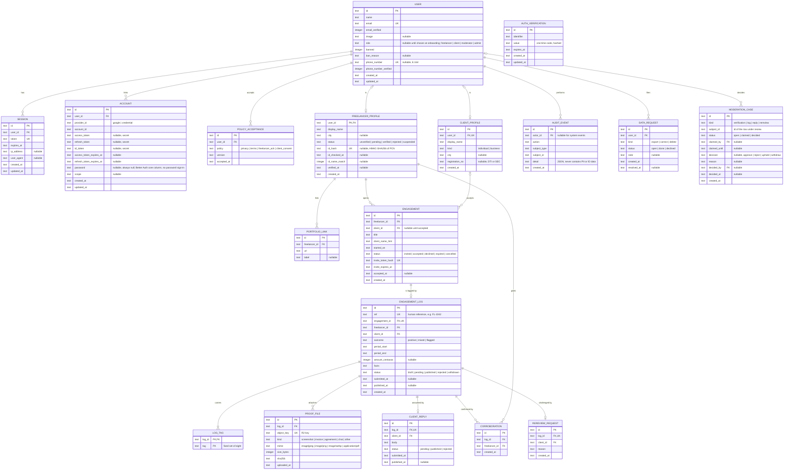

# System Design: FLAG

**PRD:** [prd-flag.md](prd-flag.md)

---

## 1. Architecture

One Next.js App Router application in `web/`, deployed to Cloudflare Workers through the OpenNext Cloudflare adapter. Server components and route handlers read and write D1 (SQLite) through Drizzle. Proof files live in a private R2 bucket and only ever pass through the Worker; no bucket is public and no presigned URL is issued. Better Auth handles sessions, Google sign-in, email one-time codes, and phone one-time codes. Turnstile protects sign-up, invite acceptance, and submission. Email goes out through Resend from inside the request with `waitUntil`. Moderation SLA status is computed at read time from timestamps, so no scheduled job is required for v1.

Every page except the landing page, sign-in, sign-up, legal pages, and the invite landing page sits in an authenticated route group. Authorization is checked a second time in the data-access layer, so a page that forgets the check still cannot read another party's data.

Deployment target: Cloudflare Workers (Paid plan recommended because the Free plan caps a Worker at 3 MiB compressed; LOG Q4). Environments: `preview` and `production`, each with its own D1 database and R2 bucket.

```
Browser (Chrome on Android, Messenger in-app browser, desktop)
   |
   v
Cloudflare Worker  ---  OpenNext adapter  ---  Next.js 16 (web/)
   |        |              |
   |        |              +-- Better Auth  (sessions, Google, email OTP, phone OTP)
   |        +-- Turnstile verify, Rate Limiting binding
   |
   +-- D1  (flag-db: accounts, profiles, engagements, logs, cases, audit)
   +-- R2  (flag-proofs: private proof files, keyed by log)
   +-- Resend (outbound email)
```

## 2. Components

Locations under `web/`. Built so far: Auth, Onboarding, Data access for the account tables, Mail. Each feature folder is owned by one developer (BUILD §4).

| Component | Responsibility | Serves | Location |
|-----------|---------------|--------|----------|
| Auth | Sessions, sign-in methods, roles, phone OTP, the `requireViewer` guard. Better Auth core plus the email-OTP plugin; the admin plugin is not used, so there is no impersonation | PRD-F7, PRD-F1 | `web/src/server/auth` |
| Onboarding | Policy versions, acknowledgment screens, the acceptance gate | PRD-F8 | `web/src/features/onboarding` |
| Verification | Phone step, portfolio links, ID check, verification case submission | PRD-F1 | `web/src/features/verification` |
| Engagements | Create engagement, invite link, client sign-up and accept or decline, client profile | PRD-F9 | `web/src/features/engagements` |
| Logs | Log form, tag rules, proof upload and streaming, submission | PRD-F2, PRD-F3 | `web/src/features/logs` |
| Moderation | Queue, claim lock, decisions with reasons, audit trail, conflict checks | PRD-F4, PRD-F13 | `web/src/features/moderation` |
| Records | Client search, client record page, aggregates, replies, corroboration | PRD-F5, PRD-F6, PRD-F10 | `web/src/features/records` |
| Data access | Drizzle schema, queries that take a viewer and enforce relationship rules | all | `web/src/server/db` |
| Design system | shadcn components on Base UI, tokens, outcome marks, record bar | all | `web/src/components` |
| Mail | Resend templates and send helper | PRD-F11 | `web/src/server/mail` |

## 3. Data model

**Schema file:** `web/src/server/db/schema.ts` (USER, SESSION, ACCOUNT, AUTH_VERIFICATION, POLICY_ACCEPTANCE so far; the other entities are design-first)

The ERD below is the schema contract (hard rule 16): code may only use the entities, fields, and relationships it defines. Types are D1/SQLite storage types as Drizzle will declare them: `text` (including ISO-8601 timestamps and enum values), `integer` (including booleans as 0/1 and money in centavos).

### 3.1 Entity-relationship diagram



`AUTH_VERIFICATION` is Better Auth's one-time-code table, renamed so it is not confused with freelancer verification. It has no relationship lines because Better Auth keys it by email or phone identifier, not by user id.

### 3.2 Entity register

| Entity | Serves | Constrained by | Data class | Retention | Notes |
|--------|--------|----------------|------------|-----------|-------|
| USER | PRD-F7 | INV-8 | PII | Life of account, then `TBD(owner)` (LOG Q5) | Better Auth core table plus admin and phone-number plugin fields |
| SESSION | PRD-F7 | INV-7 | PII | Until expiry | Better Auth core |
| ACCOUNT | PRD-F7 | — | secret | Life of account | Better Auth core; OAuth tokens |
| AUTH_VERIFICATION | PRD-F7, PRD-F1 | — | secret | Until code expiry | Better Auth one-time codes |
| POLICY_ACCEPTANCE | PRD-F8, PRD-F9 | INV-8 | internal | Life of account plus `TBD(owner)` | Append-only |
| FREELANCER_PROFILE | PRD-F1 | INV-3, INV-8 | PII | Life of account | `id_hash` only; never a PCN or image |
| PORTFOLIO_LINK | PRD-F1 | — | PII | Life of account | |
| CLIENT_PROFILE | PRD-F9, PRD-F6 | INV-6 | PII | Life of account | Exactly one per client user |
| ENGAGEMENT | PRD-F9 | INV-2 | internal | Life of the client record | Invite token stored hashed |
| ENGAGEMENT_LOG | PRD-F2, PRD-F6 | INV-1, INV-2, INV-5, INV-6 | PII | `TBD(owner)` (LOG Q5) | No score column of any kind |
| LOG_TAG | PRD-F2, PRD-F6 | — | internal | With its log | |
| PROOF_FILE | PRD-F3 | INV-2, INV-4 | PII | `TBD(owner)`; rejected logs' files deleted after `TBD(owner)` days | Bytes in R2, metadata here |
| CLIENT_REPLY | PRD-F5 | INV-1 | PII | With its log | |
| CORROBORATION | PRD-F10 | INV-8 | internal | With its log | |
| REREVIEW_REQUEST | PRD-F13 | INV-6 | PII | With its log | |
| MODERATION_CASE | PRD-F4, PRD-F1, PRD-F13 | INV-1 | internal | Kept for the life of the product | Polymorphic subject |
| AUDIT_EVENT | PRD-F4, PRD-F12 | INV-3 | internal | Kept for the life of the product | Append-only |
| DATA_REQUEST | PRD-F12 | — | PII | `TBD(owner)` | |

### 3.3 Constraints and indexes

| Constraint | On | Why | Enforces |
|------------|----|-----|----------|
| CHECK `outcome IN ('positive','mixed','flagged')` | ENGAGEMENT_LOG | Fixed outcome set | PRD-F2 |
| CHECK `tag IN` the eight fixed tags | LOG_TAG | No free-text tags | PRD-F2 |
| Tag-outcome rule (positive: at least one positive tag and no risk tag; flagged: at least one risk tag; mixed: one of each) | ENGAGEMENT_LOG + LOG_TAG | Checked in the submit handler inside the same `db.batch()`; SQLite cannot express it as a CHECK | PRD-F2 |
| Status transition `draft -> pending` only if the engagement is `accepted` and at least one PROOF_FILE row exists | ENGAGEMENT_LOG | Checked in the submit handler; a trigger `log_requires_proof` rejects the update otherwise | INV-2 |
| Status transition `pending -> published` only by the moderation decision handler | ENGAGEMENT_LOG | One code path publishes | INV-1 |
| UNIQUE `engagement_id` | ENGAGEMENT_LOG | One log per engagement | PRD-F2 |
| UNIQUE `(log_id, freelancer_id)` | CORROBORATION | One corroboration per freelancer per log | PRD-F10 |
| UNIQUE `log_id` | CLIENT_REPLY, REREVIEW_REQUEST | One reply and one re-review per log | PRD-F5, PRD-F13 |
| UNIQUE `id_hash` | FREELANCER_PROFILE | One ID per account | PRD-F1 |
| UNIQUE `user_id` | CLIENT_PROFILE | One client profile per account | PRD-F9 |
| No UPDATE or DELETE on ENGAGEMENT_LOG `facts`, `outcome`, LOG_TAG, PROOF_FILE once status is `pending` or later | ENGAGEMENT_LOG | Triggers `log_frozen_*` raise on change | INV-6 |
| Append-only: no UPDATE or DELETE | AUDIT_EVENT, POLICY_ACCEPTANCE | Triggers raise | PRD-F4, PRD-F8 |
| INDEX `(status, created_at)` | MODERATION_CASE | Oldest-first queue | PRD-F4 |
| INDEX `(client_id, status, published_at)` | ENGAGEMENT_LOG | Client record page | PRD-F6 |
| INDEX `display_name` (case-insensitive) | CLIENT_PROFILE | Client search | PRD-F6 |
| `subject_id` has no foreign key; integrity checked by the handler per `kind` | MODERATION_CASE | Polymorphic subject | PRD-F4 |
| No column named or holding a score, rating, rank, or average | all | Reviewed in schema review | INV-5 |

### 3.4 Migration policy

Drizzle Kit generates SQL migrations into `web/drizzle/`; Wrangler applies them (`wrangler d1 migrations apply`). Migrations are forward-only, reviewed in the pull request, applied to `preview` before `production`, and never edited after they reach `preview`. Triggers in §3.3 live in hand-written migration files next to the generated ones.

## 4. API surface

Mutations are Next.js server actions unless a file stream or an external caller requires a route handler. All server actions call `requireViewer()` and a role or relationship check as their first statement.

| Method | Path | Auth | Serves | Notes |
|--------|------|------|--------|-------|
| GET, POST | `/api/auth/[...all]` | Public | PRD-F7 | Better Auth handler; Turnstile on sign-up |
| action | `acceptPolicies` | Signed in | PRD-F8 | Writes POLICY_ACCEPTANCE rows for the current versions |
| action | `submitPhone`, `confirmPhoneCode` | Signed in, freelancer | PRD-F1 | Better Auth phone-number plugin |
| POST | `/api/verification/id-check` | Signed in, freelancer | PRD-F1 | Body is decoded QR text only; see [rfc-flag-id-check.md](rfc-flag-id-check.md) |
| action | `submitVerification` | Signed in, freelancer, phone verified, ID checked | PRD-F1 | Opens a `verification` MODERATION_CASE |
| action | `createEngagement` | Verified freelancer | PRD-F9 | Returns the invite URL once; stores only the token hash |
| GET | `/invite/[token]` | Public page | PRD-F9 | Shows inviter display name and what accepting means; no client data |
| action | `acceptEngagement`, `declineEngagement` | Signed in, client | PRD-F9 | Writes `client_consent` acceptance; Turnstile |
| action | `saveLogDraft`, `submitLog` | Verified freelancer, engagement owner | PRD-F2 | Enforces tag rule and proof presence |
| POST | `/api/logs/[id]/proofs` | Verified freelancer, log owner, log in `draft` | PRD-F3 | Multipart; size and signature checked; streamed to R2 |
| GET | `/api/proofs/[id]` | Moderator, filer, or named client | PRD-F3 | Streams from R2; 404 for everyone else; `Cache-Control: private, no-store` |
| GET | `/moderation` | Moderator | PRD-F4 | Queue page |
| action | `claimCase`, `releaseCase`, `decideCase` | Moderator, no conflict | PRD-F4 | Decision requires a reason; writes AUDIT_EVENT |
| GET | `/clients?q=` | Signed in | PRD-F6 | Search |
| GET | `/clients/[id]` | Signed in | PRD-F6 | Record page; `noindex` |
| action | `postReply` | Client named on the log | PRD-F5 | Opens a `reply` case |
| action | `corroborate`, `withdrawCorroboration` | Verified freelancer with an accepted engagement with that client | PRD-F10 | |
| action | `requestRereview` | Client named on the log | PRD-F13 | Once per log |
| action | `fileDataRequest`, `resolveDataRequest` | Signed in / admin | PRD-F12 | |

The only unauthenticated surfaces are the landing page, legal pages, sign-in and sign-up, the Better Auth handler, and `/invite/[token]`. The invite page reveals only the inviting freelancer's display name and the engagement title, and only to someone holding the unguessable token.

## 5. Cross-cutting concerns

| Concern | Approach | Serves |
|---------|----------|--------|
| Authentication | Better Auth sessions in an HTTP-only, Secure, SameSite=Lax cookie. Sign-in with Google or an email one-time code. Phone one-time code for freelancer verification. SMS provider `TBD(owner)` (LOG Q12) | PRD-F7, PRD-F1 |
| Authorization | `requireViewer()` returns user, role, profile status, and acknowledgment state. Route groups: `(public)`, `(onboarding)`, `(app)`, `(moderation)`. Each data-access function takes the viewer and applies the relationship rule itself | PRD-F7, PRD-F4, PRD-F6 |
| Validation | Zod schemas shared by the form and the server action; the server result is authoritative. File type by magic bytes | PRD-F2, PRD-F3 |
| Error handling | Server actions return `{ ok: true, data }` or `{ ok: false, fieldErrors, message }`. Route handlers return 400, 401, 403, 404, 409, 413, 429 with a JSON `{ error }`. A forbidden read of someone else's data returns 404, not 403 | all |
| Secrets | Wrangler secrets and `.dev.vars` locally (gitignored): `BETTER_AUTH_SECRET`, `GOOGLE_CLIENT_SECRET`, `RESEND_API_KEY`, `TURNSTILE_SECRET_KEY`, `ID_HASH_KEY`, SMS provider key | all |
| Rate limiting | Workers Rate Limiting binding for bursts (sign-in, OTP, uploads, searches) per IP and per user. Daily quotas (invites per freelancer, logs per client per freelancer) counted in D1; limits `TBD(owner)` (LOG Q7) | PRD-F1, PRD-F2, PRD-F9 |
| Privacy | No request-body logging. Observability logs carry ids, never names, phone numbers, ID data, or file contents | INV-3 |
| Crawlers | `robots.txt` disallows everything except `/`; `X-Robots-Tag: noindex, nofollow` on every authenticated route | INV-7 |
| Performance | Task routes ship no smooth-scroll or scroll-linked animation code. Images are compressed on the device before upload | PRD-F3, PRD-F6 |

### 5.1 Invariant enforcement

| INV-# | Enforced by | Location | How |
|-------|-------------|----------|-----|
| INV-1 | Logs and Records data access, Moderation decision handler | `web/src/server/db/queries/logs.ts`, `web/src/features/moderation/decide.ts` | Reader queries select `status = 'published'` unless the viewer is the filer, the client, or a moderator; only `decideCase` sets `published` |
| INV-2 | Log submit handler, D1 trigger | `web/src/features/logs/submit.ts`, `web/drizzle/0001_triggers.sql` | Submit checks engagement `accepted` and at least one PROOF_FILE in the same batch; trigger `log_requires_proof` rejects the status change otherwise |
| INV-3 | ID check handler, logging policy | `web/src/features/verification/id-check.ts` | Request body parsed in memory, HMAC of PCN stored, payload and embedded photo dropped; handler excluded from logging; no field in the ERD can hold an image or PCN |
| INV-4 | Proof stream handler | `web/src/app/api/proofs/[id]/route.ts` | Relationship check before reading R2; bucket has no public access and no custom domain; 404 otherwise |
| INV-5 | Schema review, record components | `web/src/server/db/schema.ts`, `web/src/features/records` | No score field exists; record UI renders counts and the stacked bar only; a lint test greps the schema and record components for score, rating, and rank fields |
| INV-6 | Server actions, D1 triggers | `web/src/features/records/reply.ts`, `web/drizzle/0001_triggers.sql` | No client action touches ENGAGEMENT_LOG; `log_frozen_*` triggers reject changes after submission |
| INV-7 | `(app)` route group layout, headers, robots | `web/src/app/(app)/layout.tsx`, `web/next.config.ts`, `web/src/app/robots.ts` | Layout redirects signed-out users to sign-in; data access requires a viewer; noindex headers and robots disallow |
| INV-8 | `requireVerifiedFreelancer()` guard | `web/src/server/auth/guards.ts` | Called first by `createEngagement`, `submitLog`, `corroborate`; checks `status = 'verified'` and acceptances for current policy versions |

## 6. Feature-to-design map

| PRD-F# | Designed | Components | RFC |
|--------|----------|------------|-----|
| PRD-F1 | yes | Auth, Verification, Moderation | [rfc-flag-id-check.md](rfc-flag-id-check.md) |
| PRD-F2 | yes | Logs | N/A |
| PRD-F3 | yes | Logs | N/A |
| PRD-F4 | yes | Moderation | N/A |
| PRD-F5 | yes | Records, Moderation | N/A |
| PRD-F6 | yes | Records, Data access | N/A |
| PRD-F7 | yes | Auth | N/A |
| PRD-F8 | yes | Onboarding | N/A |
| PRD-F9 | yes | Engagements | N/A |
| PRD-F10 | yes | Records | N/A |

## 7. Rejected alternatives

| Considered | Rejected because |
|-----------|------------------|
| Keep the static export | Uploads, auth, and moderation need a server |
| Vercel, Supabase, or Convex | Owner chose Cloudflare; D1, R2, and Workers cover the needs within free or $5 tiers |
| vinext instead of Next on OpenNext | Cloudflare still labels it beta (checked 2026-10-12) |
| Postgres through Hyperdrive | An open OpenNext issue breaks pg connections through Hyperdrive; D1 handles counts by client and tag at this scale |
| Denormalized `client_stats` counters | Pilot data is a few hundred rows; GROUP BY is fast and cannot drift. Revisit if the record page exceeds 200 ms at p95 |
| Presigned R2 URLs for upload and download | Presigned PUT cannot enforce the 10 MB limit, and presigned GET links can be shared; streaming through the Worker keeps one enforcement point |
| Uploading an ID photo for moderators to view | Breaks INV-3 and makes FLAG a holder of sensitive personal information under RA 10173 |
| Proxying the PhilSys verify endpoint | Not a documented public API; terms-of-service and breakage risk |
| Shadow client profiles created from a report | Breaks the handshake premise; misattribution and libel risk |
| `proxy.ts` (Next 16 replacement for middleware) for auth | On OpenNext a no-op proxy adds about 4.6 MB to the bundle (open issue as of 2026-10-12); layouts and the data layer do the check instead |
| Recharts for the record bar | A three-segment stacked bar is a few lines of markup; the chart library costs bundle size on the most-visited page |
| Lenis and scroll-linked motion across the app | Hurts input latency on low-end Android, which most pilot users have |

## 8. Open questions

- `TBD(owner)` Paid Workers plan ($5 a month) for the 10 MiB bundle limit, or try to fit the Free plan's 3 MiB? (LOG Q4)
- `TBD(owner)` Which SMS provider and who pays for phone codes? (LOG Q12)
- `TBD(owner)` Fallback verification for freelancers without a PhilID or ePhilID? (LOG Q8)
- `TBD(owner)` Retention periods for proofs, logs, rejected uploads, and closed accounts? (LOG Q5)
